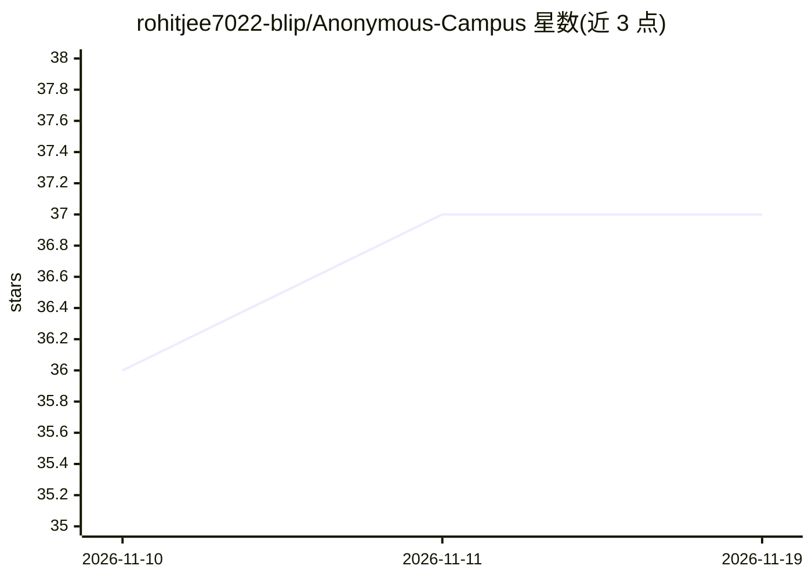

# rohitjee7022-blip/Anonymous-Campus

⭐ 37 · JavaScript · 推送 2026-11-10 · [GitHub](https://github.com/rohitjee7022-blip/Anonymous-Campus) · [官网](https://anonymous-campus-test.netlify.app) · 个人维护

**匿名校园设施反馈平台，用 AI 分析反馈并生成改进建议**

面向 IIIT Sonepat 学生的隐私优先 Web 应用：学生以校园邮箱注册后对六类设施（食堂、洗衣、Wi-Fi、宿舍、饮水、体育）提交 1-5 分评分与评论；管理员查看聚合统计、审核评论、跟踪问题并处理警告/封禁与申诉。AI 部分：调用 BharatCode AI（Qwen 3.8 27B 模型）分析聚合评分与问题数据，生成设施改进建议；原始评论与学生标识不发送给 AI。隐私上用 HMAC-SHA256 保护标识，但 README 声明不保证绝对匿名，特权后端访问可能关联账号与反馈。

## 筛选速览

| 维度 | 判定 | 备注 |
|---|---|---|
| AI 角色 | `ai-enhanced` | 去掉 AI 部分产品仍成立 |
| 许可风险 | `none` | — |
| 部署形态 | `library` | 以包/库形式分发 |
| 模型依赖 | — | README 未给出锁定关系 |
| 硬件要求 | — | 无带数字的原话,不猜 |
| 安装摩擦 | `low` | 无编译、无系统依赖或容器化 |
| 成熟度 | — | 结构信号不足 |

## 能力要点

- 六类设施的 1-5 分评分与评论提交，周提交限额
- BharatCode AI 分析聚合数据并生成改进建议（Qwen 3.8 27B）
- 账号标识以 HMAC-SHA256 保护，原始评论不发送给 AI
- 管理员仪表盘、问题跟踪、警告/七天封禁与申诉流程

## 适用场景

- 学生匿名反馈校园设施问题
- 管理员查看聚合统计并跟踪设施问题解决
- 借助 AI 生成的建议决定设施改进优先级

## 场景标签

`数据分析` · 领域:效率与自动化

## 证据(README 行号)

> L43: - BharatCode AI integration for facility insights.
> L84: 5. **AI Processing:** BharatCode AI analyses aggregated facility data and generates recommendations.

## 星数曲线

2026-11-10 36 → 2026-11-19 37（+1）

---
*卡片 v1 · prompt 1.4 · 生成 2026-11-18 · 置信度 high · 依据 README sha `89b19af2e363` · [字段定义](../../DATASET.md)*
