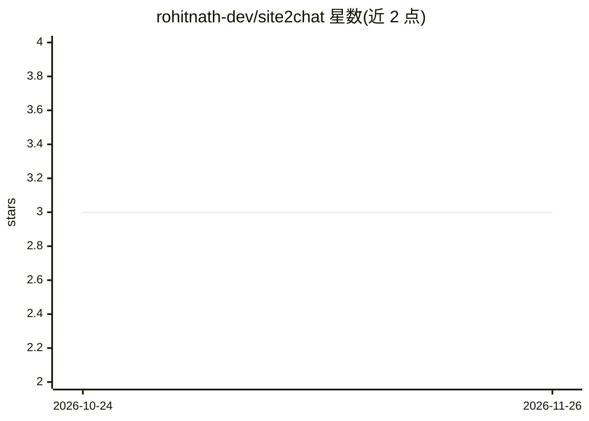

# rohitnath-dev/site2chat

⭐ — · [GitHub]() · 个人维护

**把网站内容变成可分享的 RAG AI 聊天机器人的自托管 SaaS**

由 FastAPI 后端与 React + Vite 前端组成的自托管应用：用户输入网站 URL 后，后端爬取站点页面并分块存入 PostgreSQL + pgvector（384 维向量），通过 RAG 服务生成回答；提供聊天机器人管理、对话与消息持久化、Supabase JWT 认证，以及用户 OpenRouter API key 的加密存储。前端提供仪表盘与聊天界面，支持分享或嵌入站点。README 另提供公开演示地址。

## 筛选速览

| 维度 | 判定 | 备注 |
|---|---|---|
| AI 角色 | `ai-native` | 本体是模型或模型工具 |
| 许可风险 | `permissive` | — |
| 部署形态 | `library` | 以包/库形式分发 |
| 模型依赖 | locked-api |  |
| 硬件要求 | — | 无带数字的原话,不猜 |
| 安装摩擦 | `low` | 无编译、无系统依赖或容器化 |
| 成熟度 | — | 结构信号不足 |

## 能力要点

- 网站 URL 校验与爬取、分块、向量化入库（pgvector 384 维）的完整 RAG 摄取流程
- Supabase JWT 认证的聊天机器人管理 API 与加密的 OpenRouter key 存储
- React 仪表盘 + 聊天界面，支持分享或嵌入
- 后端基于 FastAPI、SQLAlchemy、LangChain 与 faiss-cpu

## 适用场景

- 把自己的网站内容做成可分享的问答机器人
- 在现有站点中嵌入基于站点内容的 AI 聊天窗口
- 自托管一套带用户认证的 RAG 问答服务

## 场景标签

`聊天机器人` `RAG` `网页抓取` · 领域:效率与自动化

## 证据(README 行号)

> L11: Site2Chat is a FastAPI backend and React + Vite frontend that together provide a workflow for creating chatbots fro
> L28: 4. The generated content is used by the RAG service to answer user questions.
> L42: - Retrieval-augmented chat generation

## 星数曲线

2026-10-24 3 → 2026-11-26 3（+0）

---
*卡片 v1 · prompt 1.4 · 生成 2026-11-21 · 置信度 high · 依据 README sha `236284c97653` · [字段定义](../../DATASET.md)*
