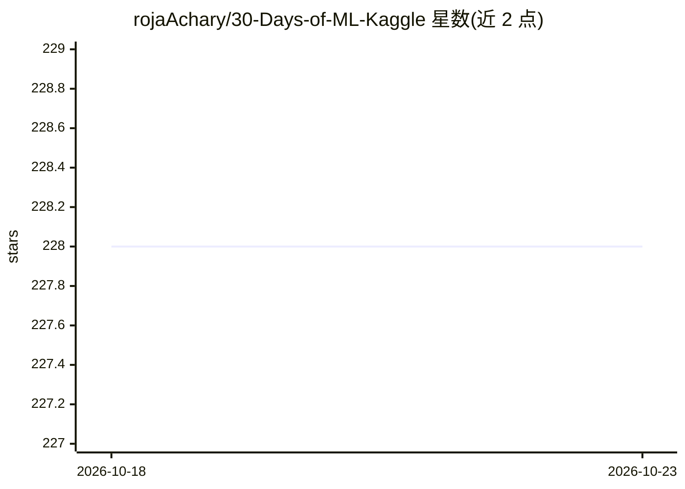

# rojaAchary/30-Days-of-ML-Kaggle

⭐ 228 · Jupyter Notebook · MIT · 推送 2026-02-11 · [GitHub](https://github.com/rojaAchary/30-Days-of-ML-Kaggle) · 个人维护

**面向零基础学习者的 30 天机器学习/Kaggle 入门课程清单**

由个人维护的 30 天机器学习动手学习计划目录：从 Python 基础、函数、列表与字典讲起，逐步覆盖数据探索、模型验证、欠拟合与过拟合、随机森林、缺失值与分类值处理、Pipelines 与交叉验证、XGBoost，最后进入 Kaggle 竞赛实践。README 以表格列出每日任务与代码链接，面向几乎没写过 Python 的初学者。原计划 2021 年 8 月开始、为期四周，含结业证书与社区聊天室等课程配套。

## 筛选速览

| 维度 | 判定 | 备注 |
|---|---|---|
| AI 角色 | `ai-knowledge` | 知识聚合/清单类 |
| 许可风险 | `permissive` | MIT |
| 部署形态 | `None` |  |
| 模型依赖 | — | README 未给出锁定关系 |
| 硬件要求 | — | 无带数字的原话,不猜 |
| 安装摩擦 | `low` | 无编译、无系统依赖或容器化 |
| 成熟度 | — | 结构信号不足 |

## 能力要点

- 按天组织的 30 天任务表（Day 01-30）与对应代码链接
- 内容覆盖 Python 基础到 XGBoost、Pipelines、交叉验证
- 面向非程序员与 Kaggle 新手设计

## 适用场景

- 零基础入门机器学习并过渡到 Kaggle 竞赛
- 按日历式任务表自学 Python 与建模流程
- 查找 XGBoost、交叉验证等入门练习的代码链接

## 场景标签

`教程课程` · 领域:学习与行业

## 证据(README 行号)

> L4: Machine learning beginner → Kaggle competitor in 30 days. Non-coders welcome
> L21: |Day📆|Task|Code Link 🔗|

## 星数曲线

2026-10-18 228 → 2026-10-23 228（+0）

---
*卡片 v1 · prompt 1.4 · 生成 2026-10-22 · 置信度 high · 依据 README sha `d4dfa046e2e8` · [字段定义](../../DATASET.md)*
