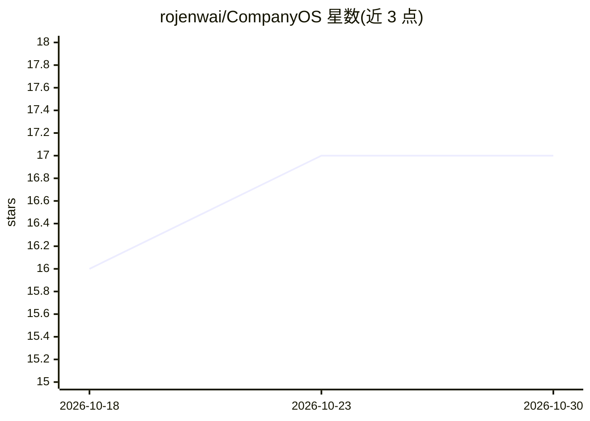

# rojenwai/CompanyOS

⭐ 17 · Python · MIT · 推送 2026-09-17 · [GitHub](https://github.com/rojenwai/CompanyOS) · 个人维护

**面向 AI 原生公司的开源运营手册与 agent 编排运行时**

一套完整公司运营框架：handbook/ 侧供人阅读，含 20 个部门手册、治理、20 阶段 SDLC、17 种文档模板、playbook 与 16 个行业起步套件；ai/ 侧供 AI 使用，含 107 个 agent 规格与编排内核。随附 runtime/ 读取 agent 规格并按需实例化、并行执行、审查汇总，无需依赖和 API key 即可运行（python -m companyos run）。面向创始人与团队，克隆后按指引删减定制。MIT 许可。

## 筛选速览

| 维度 | 判定 | 备注 |
|---|---|---|
| AI 角色 | `ai-ecosystem` | LLM/agent 周边工具 |
| 许可风险 | `permissive` | MIT |
| 部署形态 | `None` |  |
| 模型依赖 | — | README 未给出锁定关系 |
| 硬件要求 | — | 无带数字的原话,不猜 |
| 安装摩擦 | `low` | 无编译、无系统依赖或容器化 |
| 成熟度 | — | 结构信号不足 |

## 能力要点

- 20 个部门手册 + 107 个 agent 规格 + 16 个行业起步套件
- runtime 按需实例化 agent，并行执行并汇总结果，无需 API key
- 提供 scaffold.py 脚本生成新部门/agent，及四个一致性检查脚本（CI 运行）
- handbook 人类阅读 / ai 机器运行的分区结构

## 适用场景

- 克隆后定制为公司自身的组织与工程运营手册
- 让 agent 编排运行时执行如“设计并实现认证”的开发任务
- 按创业阶段（从 brainstorm 到规模化）找到对应文档与 playbook

## 场景标签

`Agent 框架` `精选清单` · 领域:Agent 开发

## 证据(README 行号)

> L34: The runtime reads the agent specs in ai/agents/ and
> L40: python -m companyos run "Design and implement authentication for a web application."

## 星数曲线

2026-10-18 16 → 2026-10-30 17（+1）

---
*卡片 v1 · prompt 1.4 · 生成 2026-10-29 · 置信度 mid · 依据 README sha `c5798e9d05fe` · [字段定义](../../DATASET.md)*
