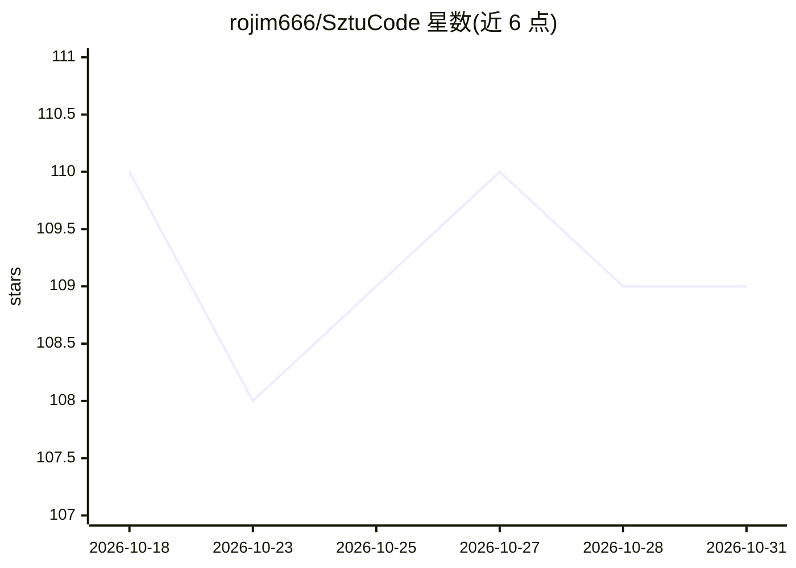

# rojim666/SztuCode

⭐ 109 · Python · MIT · 推送 2026-10-24 · [GitHub](https://github.com/rojim666/SztuCode) · [官网](https://rojim666.github.io/SztuCode/) · 组织维护 · 中文 README

**面向高校的开源全场景办公智能体：代码、文档、表格、浏览器皆为工作台**

面向高校学生与初学者的全场景办公/编程智能体实验性项目：通过 Agent Loop 执行 Word/Excel/PPT/PDF 处理、浏览器操控、图片生成与软件工程任务。采用 daemon/client 分离架构，提供 TypeScript（Tauri 2+Vue 3 桌面工作台、Node CLI，端口 7438）与 Python（Textual TUI、CLI，端口 7437）双语言实现，通过 TCP/NDJSON/JSON-RPC 通信。支持 Anthropic 与 OpenAI-compatible 双协议接入模型，内置四级权限模式、会话持久化、三层 Trace 与 SWE-bench 适配评测。项目处于 0.x 快速开发阶段，接口可能变化。

## 筛选速览

| 维度 | 判定 | 备注 |
|---|---|---|
| AI 角色 | `ai-native` | 本体是模型或模型工具 |
| 许可风险 | `permissive` | MIT |
| 部署形态 | `library` | 以包/库形式分发 |
| 模型依赖 | locked-api |  |
| 硬件要求 | — | 无带数字的原话,不猜 |
| 安装摩擦 | `low` | 无编译、无系统依赖或容器化 |
| 成熟度 | `idea` | |

## 能力要点

- TypeScript 与 Python 双语言 daemon/client 实现，协议语义共享
- ReAct Agent Runtime + Word/Excel/PPT/PDF 办公插件与 Skills
- normal/plan/accept_edits/auto 四级权限模式与范围升级留痕
- IPC/EventBus/LLM 三层 Trace 与事件回放，内置 10 个内部基准评测

## 适用场景

- 让智能体处理撰写文档、表格公式、汇报 PPT 与 PDF 解析等办公任务
- 学习并拆解 Agent Loop、工具调用、权限系统等工程实现
- 通过 Issue→PR 参与开源协作，从课堂衔接工程现场
- 用内置评测 runner 与 SWE-bench 适配评测 Agent 能力

## 场景标签

`编码 Agent` `AI 助手` `模型评测` · 领域:编码与开发

## 证据(README 行号)

> L20: SztuCode 不只面向代码仓库。作为**全场景办公智能体**，它的工作台覆盖高校学习与日常办公的完整链路：撰写与审阅 Word 文档、处理 Excel 表格与公式、生成汇报 PPT、解析 PDF 资料、操控浏览器检索信息、生成
> L62: - 把智能体接入真实办公场景：Word 文档、Excel 表格、汇报 PPT、PDF 解析、浏览器操控与图片生成；
> L133: |模型接入|Anthropic 与 OpenAI-compatible 双协议，可连接兼容服务商；保留 OpenCode 最新模型配置，并提示其免费层仅限 OpenCode 自身使用|

## 星数曲线

2026-10-18 110 → 2026-10-31 109（-1）

---
*卡片 v1 · prompt 1.4 · 生成 2026-10-23 · 置信度 mid · 依据 README sha `e865195591c0` · [字段定义](../../DATASET.md)*
