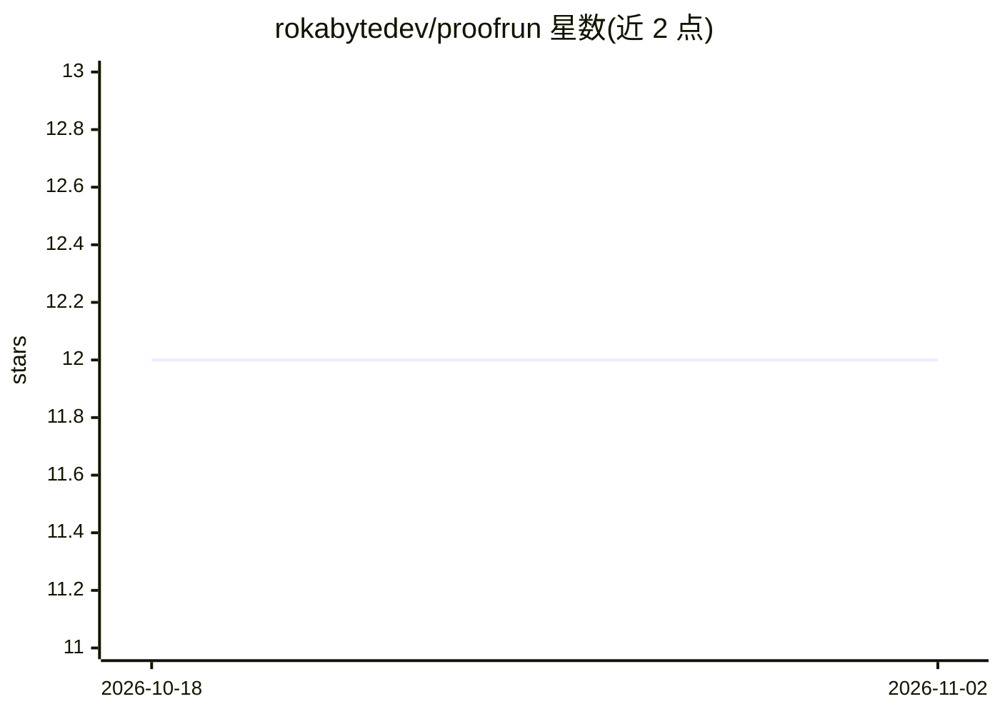

# rokabytedev/proofrun

⭐ 12 · JavaScript · MIT · 推送 2026-03-20 · [GitHub](https://github.com/rokabytedev/proofrun) · [官网](https://www.npmjs.com/package/proofrun) · 个人维护

**给编码 agent 用的验证证据采集技能：截图留证代替口头声称**

面向编码 agent 的 SKILL 技能包：agent 完成代码修改后，由其驱动打开 iOS/Android/Web 应用，逐条对照验收标准导航、截图、记录步骤并做通过/失败判定，生成本地交互式 HTML 报告供人审阅，提交反馈后 agent 自动收到通知并修复重验。工具本身不导航应用、不做判断，只提供会话管理、设备锁、证据记录与报告生成等 CLI（输出结构化 JSON）。通过 npx skills add 一条命令安装。

## 筛选速览

| 维度 | 判定 | 备注 |
|---|---|---|
| AI 角色 | `ai-ecosystem` | LLM/agent 周边工具 |
| 许可风险 | `permissive` | MIT |
| 部署形态 | `library` | 以包/库形式分发 |
| 模型依赖 | — | README 未给出锁定关系 |
| 硬件要求 | — | 无带数字的原话,不猜 |
| 安装摩擦 | `low` | 无编译、无系统依赖或容器化 |
| 成熟度 | — | 结构信号不足 |

## 能力要点

- agent 驱动的逐条验收：导航、截图、带理由的 pass/fail 判定
- 生成本地交互式 HTML 报告，含截图与评论/接受/拒绝控件，反馈自动回传 agent
- 设备锁防止多 agent 冲突，未变更标准可跨验证轮携带
- CLI 全部输出结构化 JSON 供 agent 消费

## 适用场景

- 让编码 agent 在交付前自行打开应用验证改动并附证据
- 在 spec 驱动开发流程中把验收标准转成截图留证的验证记录
- 对 AI 完成的移动端/前端改动做人工抽查审阅

## 场景标签

`编码 Agent` · 领域:编码与开发

## 证据(README 行号)

> L8: Teach your coding agent to prove its own work.
> L24: > **The agent is smart, the tool is dumb.** Proofrun doesn't know how to navigate your app, find bugs, or decide wh
> L38: npx skills add rokabytedev/proofrun/skills

## 星数曲线

2026-10-18 12 → 2026-11-02 12（+0）

---
*卡片 v1 · prompt 1.4 · 生成 2026-11-01 · 置信度 high · 依据 README sha `bd315d6110f9` · [字段定义](../../DATASET.md)*
