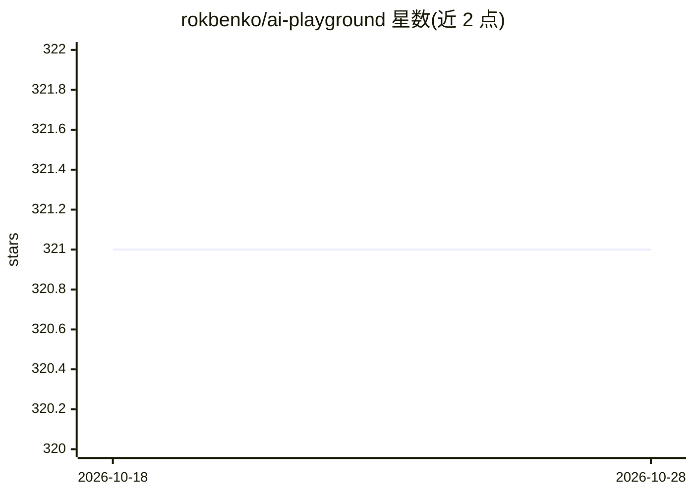

# rokbenko/ai-playground

⭐ 321 · Python · MIT · 推送 2026-04-23 · [GitHub](https://github.com/rokbenko/ai-playground) · [官网](https://www.youtube.com/@rokbenko?sub_confirmation=1) · 个人维护

**YouTube AI 编程教程配套代码合集（LLM/Agent/向量库等）**

收录 YouTube 频道 Code AI with Rok 各教程的配套代码，按主题组织：LLM 提供商（OpenAI、Google Gemini）、框架（LlamaIndex）、Agent（LangGraph、CrewAI、Fetch.ai uAgents）、云服务（Google Cloud Vertex AI、Snowflake Cortex）、监控（LangSmith）、向量数据库（Milvus/Attu）与 NLP（spaCy）。示例以 Python 和 Node.js 为主，每个教程附 GitHub 代码与视频链接，仓库内含 requirements.txt/package.json 等依赖文件。MIT 许可，作者声明不接受新增教程的直接贡献。

## 筛选速览

| 维度 | 判定 | 备注 |
|---|---|---|
| AI 角色 | `ai-knowledge` | 知识聚合/清单类 |
| 许可风险 | `permissive` | MIT |
| 部署形态 | `None` |  |
| 模型依赖 | — | README 未给出锁定关系 |
| 硬件要求 | — | 无带数字的原话,不猜 |
| 安装摩擦 | `low` | 无编译、无系统依赖或容器化 |
| 成熟度 | — | 结构信号不足 |

## 能力要点

- 覆盖 7 大主题：LLM 提供商、框架、Agent、云、监控、向量库、NLP
- 每个教程提供 Python/Node.js 示例及 GitHub 与 YouTube 链接
- 各仓库附 requirements.txt/pyproject.toml/package.json 固定依赖版本
- 含 RAG 评测、Agent 持久记忆（PostgreSQL/pgvector）、Milvus 相似度检索等进阶示例

## 适用场景

- 跟着视频学习 OpenAI/Gemini API 与各类 Agent 框架用法
- 查找 RAG、向量检索、Agent 记忆等场景的起步代码
- 对照固定依赖版本复现教程示例

## 场景标签

`教程课程` · 领域:学习与行业

## 证据(README 行号)

> L1: # Code from YouTube channel Code AI with Rok
> L11: ## 📚 Table of contents 📚
> L39: ## 👾 LLM providers 👾

## 星数曲线

2026-10-18 321 → 2026-10-28 321（+0）

---
*卡片 v1 · prompt 1.4 · 生成 2026-10-21 · 置信度 high · 依据 README sha `4c13dc9659a2` · [字段定义](../../DATASET.md)*
