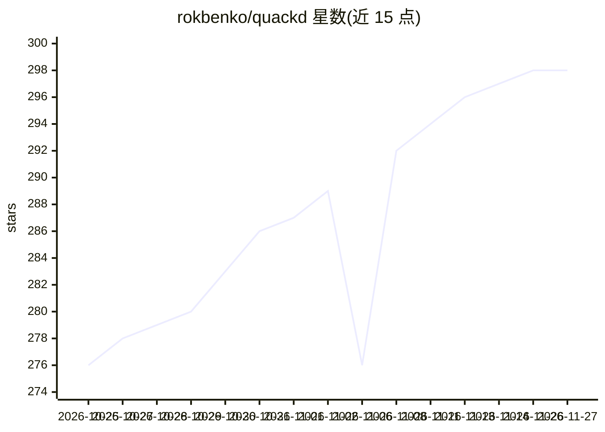

# rokbenko/quackd

⭐ 298 · Python · Apache-2.0 · 推送 2026-11-21 · [GitHub](https://github.com/rokbenko/quackd) · [官网](https://www.quackd.org) · 个人维护

**给机器人爱好者的 LLM 机器人指挥层：用自然语言驱动多台机器人协作**

以 Python 包（PyPI，Python 3.11+，Apache 2.0）形式提供的人-机与机-机通信层：每台机器人经适配器以清单声明技能，用户从终端、网页或 Claude 会话下达目标，LLM 逐次挑选技能执行直到完成或失败；多机器人组队时各自配备 LLM 并互报能力分工。内置契约限制可用技能、步数与人工确认时机。作者自述十种机器人中仅 SO-101 机械臂在真实硬件上跑过，其余九种均为 mock 后端，团队跨机器协作尚未实现。

## 筛选速览

| 维度 | 判定 | 备注 |
|---|---|---|
| AI 角色 | `ai-native` | 本体是模型或模型工具 |
| 许可风险 | `permissive` | Apache-2.0 |
| 部署形态 | `desktop` | 安装包/桌面程序 |
| 模型依赖 | local-ok | 支持本地模型 |
| 硬件要求 | — | 无带数字的原话,不猜 |
| 安装摩擦 | `low` | 无编译、无系统依赖或容器化 |
| 成熟度 | `idea` | |

## 能力要点

- 每台机器人以清单声明技能，LLM 按契约逐次调用并接受步数与人工确认限制
- 支持多家 API 厂商及本机开源 LLM（Ollama/vLLM/llama.cpp/LM Studio，无需 key）
- 所有适配器带 mock 后端，无机器人也能运行
- 可选 decision LLM 对固定选项打分，含 shadow 记录模式

## 适用场景

- 用一句话指挥 LeRobot SO-101 机械臂完成动作
- 在购置真实机器人前用 mock 后端体验指令流程
- 把多台不同类型机器人接入统一 CLI 并尝试分工

## 场景标签

`Agent 框架` · 领域:Agent 开发

## 证据(README 行号)

> L4:  Roboglot is the communication layer between people and robots, and between robots themselves. Say what you want in 
> L41: **Roboglot** is the communication layer between people and the robots they own, and between those robots. Each one 

## 星数曲线

2026-10-25 276 → 2026-11-27 298（+22）

---
*卡片 v1 · prompt 1.4 · 生成 2026-11-25 · 置信度 high · 依据 README sha `f188bcfca8bb` · [字段定义](../../DATASET.md)*
