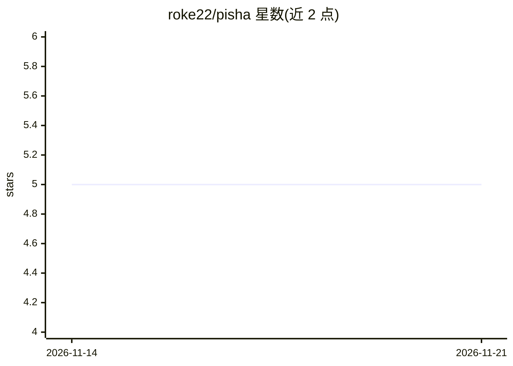

# roke22/pisha

⭐ 5 · JavaScript · MIT · 推送 2026-11-20 · [GitHub](https://github.com/roke22/pisha) · [官网](https://pisha.dev) · 个人维护

**为 Claude Code 多代理团队提供协调器与自托管仪表盘**

Pisha 给 Claude Code 加一个协调器会话，将用户请求拆成任务分派给多个 worker 会话并行执行，自动批准安全操作、仅将关键决策推送至收件箱。自托管 Node.js 服务器（零依赖）提供 web 仪表盘与 web 终端，跨多台机器运行代理；支持任务板与 GitHub Projects 双向同步、令牌用量统计、组织架构图。Codex CLI/Grok CLI 可替代部分会话（实验性）。需要 Claude Code 账户，MIT 许可。

## 筛选速览

| 维度 | 判定 | 备注 |
|---|---|---|
| AI 角色 | `ai-ecosystem` | LLM/agent 周边工具 |
| 许可风险 | `permissive` | MIT |
| 部署形态 | `self-host` | docker 或自建部署 |
| 模型依赖 | — | README 未给出锁定关系 |
| 硬件要求 | — | 无带数字的原话,不猜 |
| 安装摩擦 | `low` | 无编译、无系统依赖或容器化 |
| 成熟度 | — | 结构信号不足 |

## 能力要点

- 协调器自动拆分任务、分派 worker 并批准安全操作，无人值守运行
- 自托管 web 仪表盘：收件箱决策、实时终端墙、组织架构图
- 任务板与 GitHub Projects 双向同步，token 用量按团队/模型统计并导出 CSV
- 可混用 Codex CLI 或 Grok CLI 会话（实验性）

## 适用场景

- 跨多个仓库并行开发一个功能，由协调器保持同步
- 把大型迁移/重构拆成并行任务交给多个代理
- 离开电脑后让代理团队持续工作，回来从收件箱处理关键决策

## 场景标签

`多智能体` `编码 Agent` · 领域:Agent 开发

## 证据(README 行号)

> L23: Pisha is **multi-agent orchestration for Claude Code**: parallel Claude Code sessions on one machine or many, coord
> L88: - **The coordinator** is a Claude Code session with the coordinator role. It turns your request into tasks, assigns
> L90: - **`pisha-server`** relays messages between agents and serves the dashboard. Agents connect *out* to it, so their 

## 星数曲线

2026-11-14 5 → 2026-11-21 5（+0）

---
*卡片 v1 · prompt 1.4 · 生成 2026-11-21 · 置信度 high · 依据 README sha `61f8e2131fc4` · [字段定义](../../DATASET.md)*
