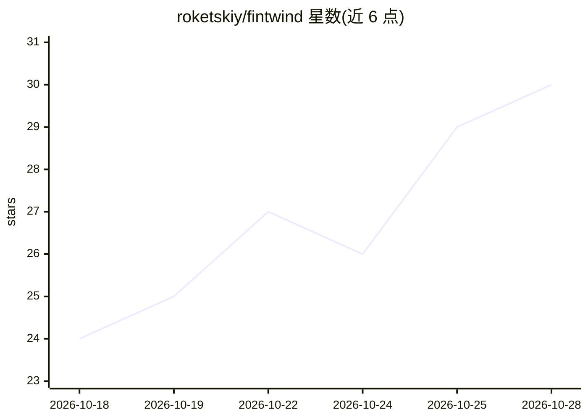

# roketskiy/fintwind

⭐ 30 · Rust · GPL-3.0 · 推送 2026-10-28 · [GitHub](https://github.com/roketskiy/fintwind) · [官网](https://fintwind.xyz) · 个人维护 · 中文 README

**OpenCode 2 的原生 Windows 桌面客户端（Rust+GPUI）**

基于 Rust 与 GPUI（非 Electron）构建的 Windows 原生桌面应用，为 OpenCode 2 编码 agent 提供图形界面：按项目管理会话、多会话标签页、查看流式回复/推理/工具调用、文件浏览与 diff、Git 提交图、内置终端与可选 WebView2 浏览器面板、MCP 管理与定时任务。要求本机已安装 opencode CLI（npm 或 Bun 安装），由 fintwind 自行启动私有本地服务器。是 waku（EGOIST）的独立 GPL-3.0-only 分支，仅支持 OpenCode 2 作为 agent 后端，仅面向 Windows 10 1809+/Windows 11。本地 SQLite 存储数据，无账号与云同步；推理需发送到用户配置的模型提供商。

## 筛选速览

| 维度 | 判定 | 备注 |
|---|---|---|
| AI 角色 | `ai-ecosystem` | LLM/agent 周边工具 |
| 许可风险 | `viral` | GPL-3.0 |
| 部署形态 | `desktop` | 安装包/桌面程序 |
| 模型依赖 | — | README 未给出锁定关系 |
| 硬件要求 | — | 无带数字的原话,不猜 |
| 安装摩擦 | `low` | 无编译、无系统依赖或容器化 |
| 成熟度 | — | 结构信号不足 |

## 能力要点

- 原生 GPUI 界面，多会话标签、流式回复/推理/工具活动可视化
- 复用 OpenCode 的模型、提供商凭据与 MCP 配置，自启动私有本地服务器
- 内置终端、WebView2 浏览器面板（可由 agent 操作浏览器标签）、Mermaid 图与数学公式渲染
- 定时任务、旧会话清理、上下文组成 treemap、本地使用统计热图

## 适用场景

- 在图形界面里管理 OpenCode 编码 agent 的多个项目与会话
- 查看 agent 的回复、推理过程与工具调用并检查代码 diff 和 Git 历史
- 配置定时指令任务并配合 MCP 服务器扩展 agent 能力

## 场景标签

`编码 Agent` · 领域:编码与开发

## 证据(README 行号)

> L5: A native Windows desktop client for OpenCode 2.
> L156: OpenCode 2 as its only agent backend. Multiple model providers are available

## 星数曲线

2026-10-18 24 → 2026-10-28 30（+6）

---
*卡片 v1 · prompt 1.4 · 生成 2026-10-26 · 置信度 mid · 依据 README sha `bc901eee0d0a` · [字段定义](../../DATASET.md)*
