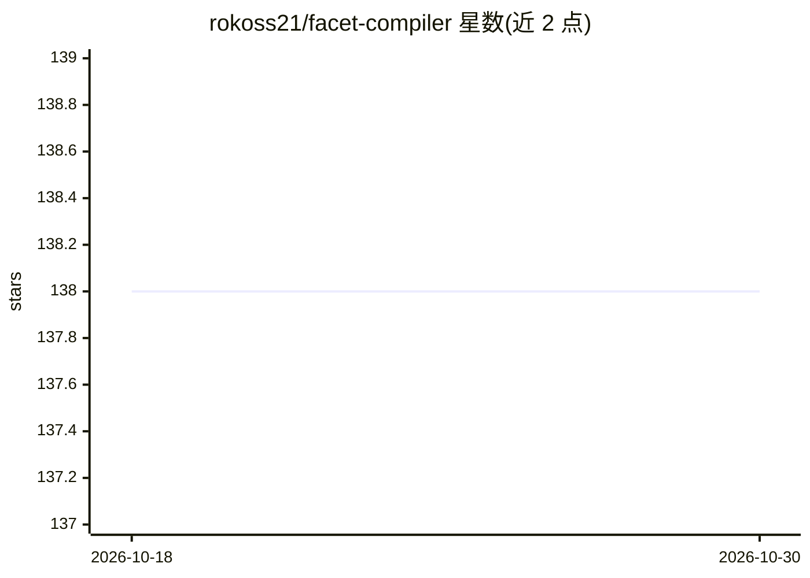

# rokoss21/facet-compiler

⭐ 138 · Rust · Apache-2.0 · 推送 2026-08-21 · [GitHub](https://github.com/rokoss21/facet-compiler) · [官网](https://rokoss21.github.io/facet-compiler/) · 个人维护

**FACET 规约的 Rust 编译器/运行时：把 .facet 契约编译为确定性 AI 请求上下文**

面向使用 LLM 的开发者的命令行工具：将 `.facet` 契约文件经规范化、解析、类型检查、计算、布局、渲染的确定性流水线，编译为规范化 JSON 输出的策略感知请求上下文，含显式失败码（F* 系列）、fail-closed 的策略守卫、稳定的文档与策略哈希。提供 build/run/test/inspect/codegen 等 CLI 命令，支持在 CI 中验证契约。明确不保证模型生成输出或外部 API 的确定性。以 Rust 实现，可通过 cargo、发布二进制或源码构建安装。

## 筛选速览

| 维度 | 判定 | 备注 |
|---|---|---|
| AI 角色 | `ai-ecosystem` | LLM/agent 周边工具 |
| 许可风险 | `permissive` | Apache-2.0 |
| 部署形态 | `library` | 以包/库形式分发 |
| 模型依赖 | — | README 未给出锁定关系 |
| 硬件要求 | — | 无带数字的原话,不猜 |
| 安装摩擦 | `medium` | 含编译或系统依赖之一 |
| 成熟度 | — | 结构信号不足 |

## 能力要点

- 六阶段确定性流水线（规范化→解析→类型检查→计算→布局→渲染）
- fail-closed 策略守卫与显式失败码（F454/F455 等）
- 规范化 JSON 输出与稳定的文档/策略哈希
- 棕地集成路径：保留现有 provider SDK，仅替换 prompt 组装环节

## 适用场景

- 在 CI 中验证 LLM prompt 契约的合法性与一致性
- 把 prompt 组装替换为确定性编译产物以保证可复现
- 为 AI 请求附加策略与守卫约束并 fail-closed 失败

## 场景标签

`提示工程` · 领域:Agent 开发

## 证据(README 行号)

> L10: Deterministic compiler and execution layer for **FACET v2.1.3**.
> L12: `facet-fct` compiles `.facet` contracts into canonical, policy-aware AI request context with explicit failure seman
> L161: 2. Replace prompt assembly with `facet-fct run`.

## 星数曲线

2026-10-18 138 → 2026-10-30 138（+0）

---
*卡片 v1 · prompt 1.4 · 生成 2026-10-22 · 置信度 high · 依据 README sha `c74a260c481c` · [字段定义](../../DATASET.md)*
