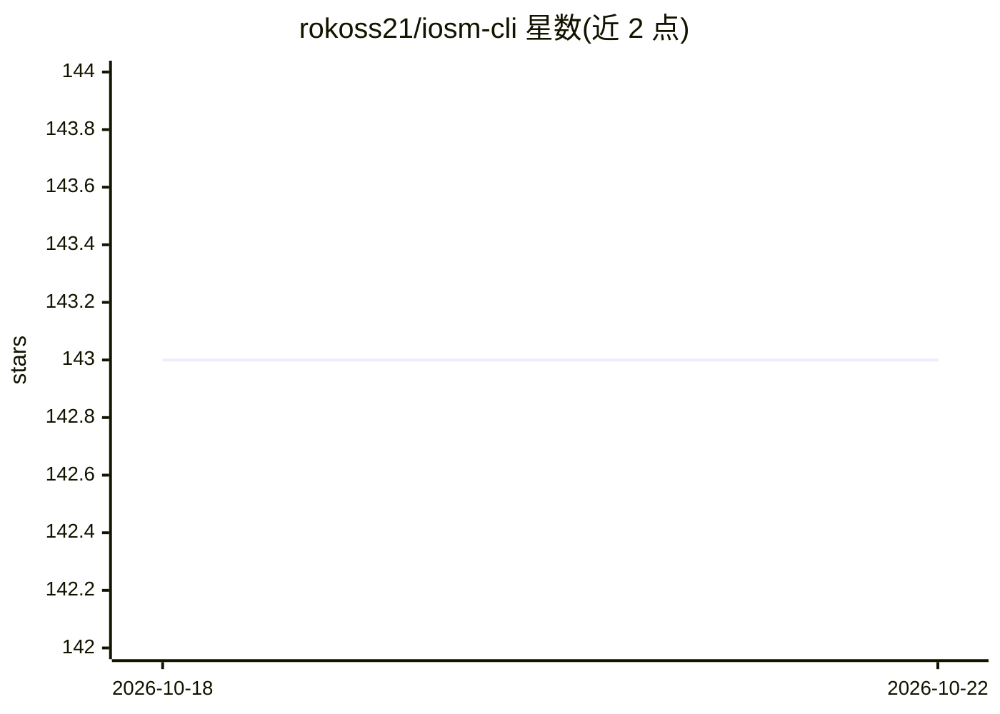

# rokoss21/iosm-cli

⭐ 143 · TypeScript · MIT · 推送 2026-04-11 · [GitHub](https://github.com/rokoss21/iosm-cli) · [官网](https://www.npmjs.com/package/iosm-cli) · 个人维护

**面向专业开发者的终端 AI 编码运行时与 IOSM 工程方法论**

基于 Node.js 的终端编码 agent CLI：在交互式 TUI 中提供文件读写、搜索、编辑与 shell 工具，支持后台任务、会话恢复与项目记忆。核心机制包括 /contract→/singular→/swarm 的受控变更编排（锁、门禁、检查点、确定性回滚）、文件系统快照与回滚、并行子代理与共享内存，以及 IOSM 四阶段（Improve/Optimize/Shrink/Modularize）改进循环，用六项规范指标与 IOSM-Index 聚合分跟踪进度，产物写入 .iosm/ 目录。通过环境变量接入多家模型提供商，支持 MCP 服务器与 TypeScript 扩展，提供 JSON-RPC、Telegram 桥接等集成模式。限制：需 Node.js>=20.6.0 与至少一个已认证的模型提供商。

## 筛选速览

| 维度 | 判定 | 备注 |
|---|---|---|
| AI 角色 | `ai-native` | 本体是模型或模型工具 |
| 许可风险 | `permissive` | MIT |
| 部署形态 | `library` | 以包/库形式分发 |
| 模型依赖 | locked-api |  |
| 硬件要求 | — | 无带数字的原话,不猜 |
| 安装摩擦 | `low` | 无编译、无系统依赖或容器化 |
| 成熟度 | — | 结构信号不足 |

## 能力要点

- /contract→/singular→/swarm 受控变更编排：锁、门禁、重试与检查点
- IOSM 四阶段改进循环与六项规范指标、IOSM-Index 聚合健康分
- 文件系统 checkpoint/rollback 与确定性回滚顺序
- Policy Engine v2 分层权限解析与扩展源信任账本/完整性校验

## 适用场景

- 在终端里对真实代码库做实现、重构与架构审查
- 以只读 plan profile 做代码审查或熟悉陌生代码库
- 用 IOSM 循环对代码库做可度量、留痕的持续改进

## 场景标签

`编码 Agent` `多智能体` `代码审查` · 领域:Agent 开发

## 证据(README 行号)

> L19: Most AI CLIs are optimized for conversation. **IOSM CLI is optimized for controlled engineering execution** — worki
> L61: |**Everyday coding**|Interactive terminal session with file, search, edit, and shell tools|
> L68: |**Integrations**|Interactive TUI, print mode, JSON event stream, JSON-RPC server, Telegram bridge, TypeScript SDK|

## 星数曲线

2026-10-18 143 → 2026-10-22 143（+0）

---
*卡片 v1 · prompt 1.4 · 生成 2026-10-22 · 置信度 high · 依据 README sha `2a69f84262d1` · [字段定义](../../DATASET.md)*
