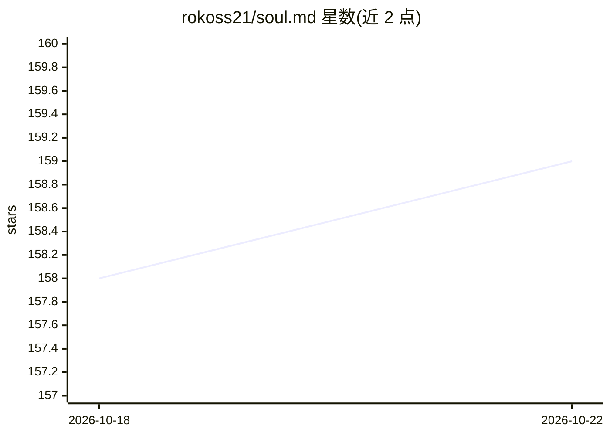

# rokoss21/soul.md

⭐ 159 · NOASSERTION · 推送 2026-02-11 · [GitHub](https://github.com/rokoss21/soul.md) · [官网](https://github.com/rokoss21/soul.md) · 个人维护

**AI agent 人设的跨平台可移植规范（Soul.md RFC-1）**

声明式规范（RFC-1，1.0.0-rc1 草案），用 Markdown/YAML front-matter 描述 AI agent 的人设：身份、语音风格、交互策略、认知方式、决策倾向与安全护栏，与人设之外的工具/项目配置分离。支持组合（extends/mixins）、profiles 模式切换、基于触发器的动态状态（moods）与自动一致性测试。定位为跨运行时可移植（OpenAI、Anthropic、本地模型、自定义运行时）。README 中的运行与校验命令标注为假设性示例，规范以文档形式提供，采用 CC BY 4.0 许可。

## 筛选速览

| 维度 | 判定 | 备注 |
|---|---|---|
| AI 角色 | `ai-ecosystem` | LLM/agent 周边工具 |
| 许可风险 | `none` | NOASSERTION |
| 部署形态 | `None` |  |
| 模型依赖 | — | README 未给出锁定关系 |
| 硬件要求 | — | 无带数字的原话,不猜 |
| 安装摩擦 | `low` | 无编译、无系统依赖或容器化 |
| 成熟度 | `idea` | |

## 能力要点

- 声明式描述 persona 的 YAML front-matter 规范
- extends/mixins 组合与确定性合并语义
- profiles 模式切换与触发器驱动的动态状态（moods）
- 定义一致性测试与测试提示词（CTS-1）

## 适用场景

- 为同一 agent 在不同平台/运行时保持一致人设
- 组合复用的人设模块（基类与 mixins）
- 自动化测试 agent 行为是否符合既定人设

## 场景标签

 · 领域:AI agent 规范/配置

## 证据(README 行号)

> L13: **Soul.md** is a declarative specification for describing an AI agent's **persona** — its identity, voice, interact
> L21: ✅ **Portability**: Write once, use across different platforms (OpenAI, Anthropic, local models, custom runtimes)

## 星数曲线

2026-10-18 158 → 2026-10-22 159（+1）

---
*卡片 v1 · prompt 1.4 · 生成 2026-10-22 · 置信度 high · 依据 README sha `b5b46cb5e84d` · [字段定义](../../DATASET.md)*
