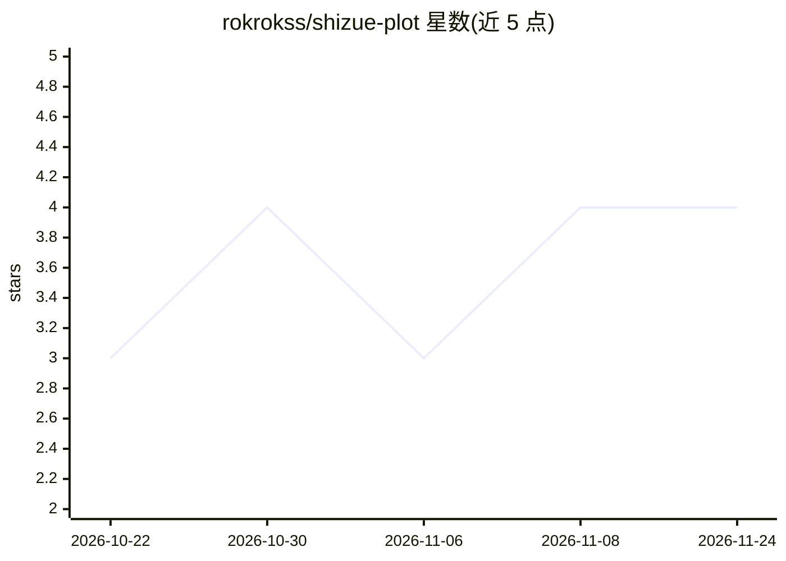

# rokrokss/shizue-plot

⭐ — · [GitHub]() · 个人维护

**本地运行的 RisuAI/SillyTavern 角色卡聊天应用**

在个人电脑上运行的角色聊天应用，读取并按原应用方式播放 RisuAI 与 SillyTavern 角色卡（V1-V3、.png/.charx/.json、.risum 模块与 lorebook），可从 RisuRealm 粘贴链接整卡导入。模型侧支持用已有 ChatGPT 订阅登录、自有 API key，或本机无密钥服务器。数据全部留在本机一个文件夹内，UI 提供韩/英/日三语，手机可通过 QR 码配对使用。不含图像与语音生成、RisuAI 插件及 WebLLM。

## 筛选速览

| 维度 | 判定 | 备注 |
|---|---|---|
| AI 角色 | `ai-native` | 本体是模型或模型工具 |
| 许可风险 | `viral` | — |
| 部署形态 | `library` | 以包/库形式分发 |
| 模型依赖 | local-ok | 支持本地模型 |
| 硬件要求 | — | 无带数字的原话,不猜 |
| 安装摩擦 | `low` | 无编译、无系统依赖或容器化 |
| 成熟度 | — | 结构信号不足 |

## 能力要点

- 导入并播放 RisuAI/SillyTavern 角色卡，含 CBS、lorebook、正则脚本、Lua、群聊、HypaV3 记忆等特性
- 支持 ChatGPT 订阅登录及 RisuAI 的全部请求格式（OpenAI/Anthropic/Google/Bedrock/OpenRouter 等）
- 本地无密钥服务器支持：Ollama、LM Studio、llama.cpp、vLLM、KoboldCpp、text-generation-webui
- 一条命令启动、无 Docker；数据存于单一文件夹，支持一键备份与 QR 码手机配对

## 适用场景

- 在本地电脑上玩 RisuAI/SillyTavern 角色卡而不用开他们的网页
- 用已有的 ChatGPT 订阅聊天而不另付 API 费用
- 把 RisuAI 或 SillyTavern 的存量卡片、聊天记录整体迁过来
- 手机通过 QR 码连接电脑上的角色聊天

## 场景标签

`聊天机器人` · 领域:对话与助手

## 证据(README 行号)

> L3:  A character-chat app you run on your own computer.
> L19: shizue is a character-chat app for one person on their own computer, as RisuAI
> L51: - Every request format RisuAI has: OpenAI, Anthropic, Google AI Studio and

## 星数曲线

2026-10-22 3 → 2026-11-24 4（+1）

---
*卡片 v1 · prompt 1.4 · 生成 2026-11-21 · 置信度 high · 依据 README sha `03bbc01f034e` · [字段定义](../../DATASET.md)*
