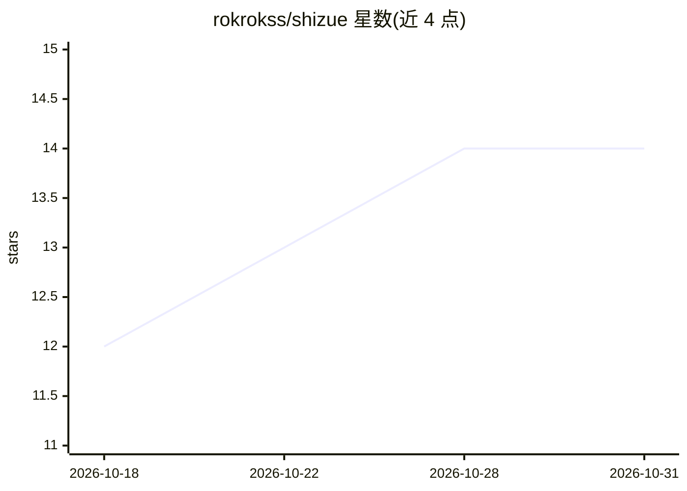

# rokrokss/shizue

⭐ 14 · TypeScript · MIT · 推送 2026-10-30 · [GitHub](https://github.com/rokrokss/shizue) · [官网](https://shizue.net) · 个人维护

**集成 LLM 的 Chrome 侧边栏：聊天、网页摘要与双语翻译**

MIT 许可的 Chrome 扩展，把 LLM 引入日常浏览：侧边栏 AI 聊天、一键网页摘要、网页双语对照阅读，以及在 YouTube/Twitch/Netflix 上显示原文+译文的字幕。接入方式包括 Sign in with ChatGPT（使用用户的 ChatGPT 订阅）、自有 OpenAI/Gemini/Anthropic API key、OpenRouter 单一 key，以及 Ollama/LM Studio/llama.cpp 本地模型（无需 API key）。API key 与聊天记录仅存于浏览器本地，无 Shizue 服务器与追踪。另有笔记、23 种界面语言、图片 OCR 等功能；Firefox 不支持。

## 筛选速览

| 维度 | 判定 | 备注 |
|---|---|---|
| AI 角色 | `ai-native` | 本体是模型或模型工具 |
| 许可风险 | `permissive` | MIT |
| 部署形态 | `library` | 以包/库形式分发 |
| 模型依赖 | local-ok | 支持本地模型 |
| 硬件要求 | — | 无带数字的原话,不猜 |
| 安装摩擦 | `low` | 无编译、无系统依赖或容器化 |
| 成熟度 | — | 结构信号不足 |

## 能力要点

- 支持 Sign in with ChatGPT（用订阅而非 API key）与 BYOK 多供应商接入
- YouTube/Twitch/Netflix 双语字幕，部分路径本地完成无需 AI 请求
- 支持 Ollama/LM Studio/llama.cpp 本地模型，无 API key
- API key、聊天与笔记仅存浏览器本地，无服务器与追踪

## 适用场景

- 浏览网页时在侧边栏与 AI 对话或一键摘要当前页面
- 看 YouTube/Twitch/Netflix 时显示原文+母语双语字幕
- 双语对照阅读外文网页辅助语言学习
- 用本地模型完成翻译，内容不离开电脑

## 场景标签

`聊天机器人` `OCR` · 领域:对话与助手

## 证据(README 行号)

> L16: Shizue is a Chrome extension designed for integrating Large Language Models (LLMs) into the daily Browse workflow. 
> L18: Shizue provides a free, open-source alternative to commercial services (e.g., Sider) that **restricts access to new

## 星数曲线

2026-10-18 12 → 2026-10-31 14（+2）

---
*卡片 v1 · prompt 1.4 · 生成 2026-10-31 · 置信度 mid · 依据 README sha `bb07dfb24e53` · [字段定义](../../DATASET.md)*
