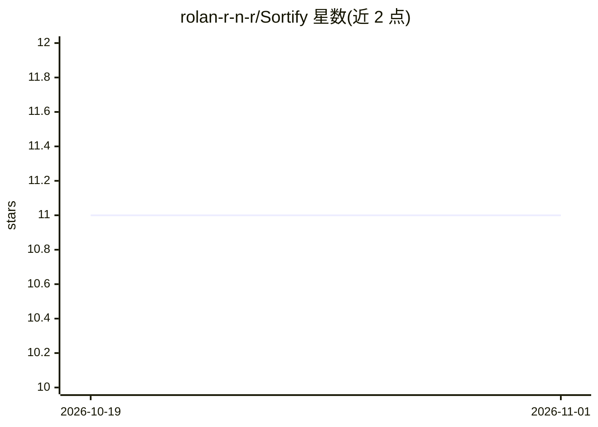

# rolan-r-n-r/Sortify

⭐ 11 · Python · MIT · 推送 2026-03-21 · [GitHub](https://github.com/rolan-r-n-r/Sortify) · 个人维护

**本地 AI 驱动的桌面文件自动整理工具，按内容智能分类**

面向个人用户的文件整理桌面应用（PyQt6 GUI + CLI）。使用本地 Sentence Transformers（all-MiniLM-L6-v2）对文件内容做语义理解，结合 PyPDF2/python-docx 提取文档文本、OpenCV 分析图像，按内容而非扩展名分类；支持检测 AI 生成图像元数据、自然语言命令（spaCy 解析，实验性）、文件夹实时监控与定时整理。安全机制包括 SQLite 撤销历史、dry-run 预览、批量原子回滚。全程离线运行，首次启动需联网下载约 80MB 模型；Windows 提供安装包，macOS/Linux 需从源码运行。

## 筛选速览

| 维度 | 判定 | 备注 |
|---|---|---|
| AI 角色 | `ai-enhanced` | 去掉 AI 部分产品仍成立 |
| 许可风险 | `permissive` | MIT |
| 部署形态 | `desktop` | 安装包/桌面程序 |
| 模型依赖 | — | README 未给出锁定关系 |
| 硬件要求 | — | 无带数字的原话,不猜 |
| 安装摩擦 | `low` | 无编译、无系统依赖或容器化 |
| 成熟度 | `idea` | |

## 能力要点

- 本地 Sentence Transformers 语义理解文件内容，离线运行
- AI 生成图像检测（Midjourney/DALL-E/Stable Diffusion 元数据）
- SQLite 撤销历史、dry-run 预览与批量原子回滚
- 文件夹实时监控与自然语言命令（实验性）

## 适用场景

- 自动清理多年堆积的 Downloads 文件夹
- 按内容区分发票、收据与普通 PDF 并归档
- 让新文件落入监控文件夹后自动分类
- 摄影师批量区分 RAW/JPEG 并筛出 AI 生成图

## 场景标签

 · 领域:桌面工具/文件管理

## 证据(README 行号)

> L19: **Sortify is your AI-powered cleanup crew.** It's not just another file organizer—it actually *understands* what yo
> L32: - Uses **Sentence Transformers** (`all-MiniLM-L6-v2`) for semantic understanding
> L68: - Beautiful **PyQt6 GUI** with drag-and-drop support

## 星数曲线

2026-10-19 11 → 2026-11-01 11（+0）

---
*卡片 v1 · prompt 1.4 · 生成 2026-11-01 · 置信度 mid · 依据 README sha `22333b3a60c7` · [字段定义](../../DATASET.md)*
