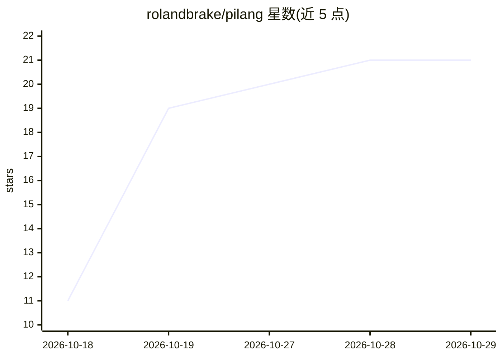

# rolandbrake/pilang

⭐ 21 · C · MIT · 推送 2026-10-28 · [GitHub](https://github.com/rolandbrake/pilang) · [官网](https://pi-lang.netlify.app/) · 个人维护

**C 实现的数值计算与可视化脚本语言，面向实验型开发者**

Pilang 是用 C 编写的轻量通用脚本语言，定位为数值计算、仿真、可视化实验与小型交互程序的开发工具。内置张量、图像处理、2D 图表、交互式 3D 绘图、绘图与音频模块，支持类、继承、闭包与运算符钩子等语言特性；可将脚本编译为 .px 字节码项目文件或打包为独立 Windows 可执行文件，浏览器构建基于 WebAssembly。Windows/Linux x64 提供预编译发布包与源码构建套件（make release），macOS 尚未发布官方构建，静态链接无需 SDL 动态库。

## 筛选速览

| 维度 | 判定 | 备注 |
|---|---|---|
| AI 角色 | `ai-enhanced` | 去掉 AI 部分产品仍成立 |
| 许可风险 | `permissive` | MIT |
| 部署形态 | `desktop` | 安装包/桌面程序 |
| 模型依赖 | — | README 未给出锁定关系 |
| 硬件要求 | — | 无带数字的原话,不猜 |
| 安装摩擦 | `medium` | 含编译或系统依赖之一 |
| 成熟度 | `idea` | |

## 能力要点

- 内置张量、图像处理、2D/3D 绘图与音频模块
- 支持 .px 字节码项目文件与 Windows 独立可执行文件打包
- WebAssembly 浏览器构建与在线 playground
- 静态链接运行时，无需 SDL DLL 或 .so 依赖

## 适用场景

- 做数值计算与仿真时快速绘图与交互式 3D 可视化
- 开发小型交互游戏并打包为浏览器或 Windows 版本
- 在单一语言内完成数据处理、运算与可视化实验

## 场景标签

 · 领域:编程语言/数值与可视化计算

## 证据(README 行号)

> L21: first. It is a C-powered scripting language for numerical work, simulations,
> L24: Tensors, image processing, 2D charts, interactive 3D plots, drawing, and audio
> L196: Pilang includes native SDL-backed drawing and plotting modules for quick visual feedback while experimenting with 

## 星数曲线

2026-10-18 11 → 2026-10-29 21（+10）

---
*卡片 v1 · prompt 1.4 · 生成 2026-10-28 · 置信度 high · 依据 README sha `e0ab634b0749` · [字段定义](../../DATASET.md)*
