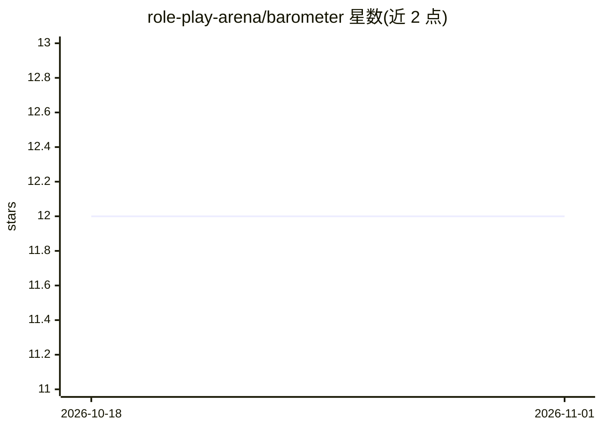

# role-play-arena/barometer

⭐ 12 · TypeScript · NOASSERTION · 推送 2026-08-31 · [GitHub](https://github.com/role-play-arena/barometer) · [官网](https://roleplayarena.com) · 组织维护

**AI 角色扮演聊天机器人社区情感基准，基于真实用户评价**

面向 AI roleplay 聊天服务（Character.AI、Janitor AI、SpicyChat、PolyBuzz、Talkie、Emochi 等）的社区情感评分基准：从各服务官方 subreddit 帖子与应用商店官方应用评论滚动采集 30 天窗口数据，Reddit 帖用 LLM 按 -1/0/+1 标注情感，商店星级直接映射，再做加权均值与贝叶斯收缩算出 0-100 分。数据 CC BY 4.0 开放、代码 MIT，标签文件去水化仅存帖子 id 供自行核验，每天刷新两次。

## 筛选速览

| 维度 | 判定 | 备注 |
|---|---|---|
| AI 角色 | `ai-knowledge` | 知识聚合/清单类 |
| 许可风险 | `none` | NOASSERTION |
| 部署形态 | `library` | 以包/库形式分发 |
| 模型依赖 | — | README 未给出锁定关系 |
| 硬件要求 | — | 无带数字的原话,不猜 |
| 安装摩擦 | `low` | 无编译、无系统依赖或容器化 |
| 成熟度 | — | 结构信号不足 |

## 能力要点

- LLM 仅输出逐帖 -1/0/+1 情感标签，评分由约 40 行算术代码完成并附测试
- 去水化标签文件（仅帖子 id），可经 Reddit API 自行复水核验
- 数据 CC BY 4.0、代码 MIT，含逐窗口历史快照与主题汇总

## 适用场景

- 查看各 AI roleplay 服务的近期用户口碑排名
- 获取带出处 id 的情感标签数据做二次研究
- 引用可复现的社区情感评分写分析文章

## 场景标签

`模型评测` · 领域:评测与运维

## 证据(README 行号)

> L3: Community-sentiment benchmark for AI roleplay chatbots — Character.AI, Janitor AI, SpicyChat, PolyBuzz, Talkie, Emoc
> L25: 2. **Label Reddit** posts `-1 / 0 / +1` by sentiment toward the service with an LLM. The full labeling rubric — the

## 星数曲线

2026-10-18 12 → 2026-11-01 12（+0）

---
*卡片 v1 · prompt 1.4 · 生成 2026-11-01 · 置信度 high · 依据 README sha `a9f423687d86` · [字段定义](../../DATASET.md)*
