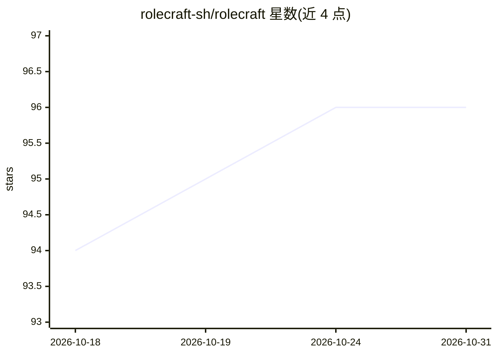

# rolecraft-sh/rolecraft

⭐ 96 · JavaScript · MIT · 推送 2026-10-30 · [GitHub](https://github.com/rolecraft-sh/rolecraft) · [官网](https://rolecraft-sh.github.io/rolecraft/) · 组织维护

**面向 AI agent 的技能/MCP 管理器，安装前做静态安全扫描**

零依赖的 Node.js CLI，用于在 90 种 AI agent（65 种经验证）间安装、列出、测试与移除 skills，并为其中 9 种安装 MCP 服务器。核心机制是安装前对技能文件做正则式静态分析，检测提示注入、命令注入、混淆代码与凭据收集并给出 0-100 分级（SAFE/REVIEW/DANGER）。支持本地目录、GitHub/GitLab/SSH、npm 等来源，提供 profile 配置系统、CI 锁文件重装与 Node.js API。README 明确列出扫描局限：不解读自然语言指令，uvx/pipx 等来源的 MCP 服务器不扫描。

## 筛选速览

| 维度 | 判定 | 备注 |
|---|---|---|
| AI 角色 | `ai-ecosystem` | LLM/agent 周边工具 |
| 许可风险 | `permissive` | MIT |
| 部署形态 | `library` | 以包/库形式分发 |
| 模型依赖 | — | README 未给出锁定关系 |
| 硬件要求 | — | 无带数字的原话,不猜 |
| 安装摩擦 | `low` | 无编译、无系统依赖或容器化 |
| 成熟度 | — | 结构信号不足 |

## 能力要点

- 安装前静态安全扫描（提示注入/命令注入/混淆代码/凭据收集），0-100 分级
- 覆盖 90 种 agent 的 skill 管理，MCP 服务器单命令安装
- 零运行时依赖，仅用 Node.js 内置模块
- 提供 CI 锁文件重装（rolecraft ci）、profile 系统与 Node.js API

## 适用场景

- 在多个 AI agent 间统一安装和同步 skills 与 MCP 服务器
- 安装社区技能前先做安全扫描再决定是否放行
- 用 lockfile 在 CI 中重放技能安装

## 场景标签

`网络安全` · 领域:学习与行业

## 证据(README 行号)

> L6:  Static security scoring before any skill is installed · Skills across 90 agents (65 verified) · MCP servers for the
> L62: - **Security scoring** — static analysis before every install: prompt injection, command injection, obfuscated code

## 星数曲线

2026-10-18 94 → 2026-10-31 96（+2）

---
*卡片 v1 · prompt 1.4 · 生成 2026-10-23 · 置信度 high · 依据 README sha `e9fc65fa426d` · [字段定义](../../DATASET.md)*
