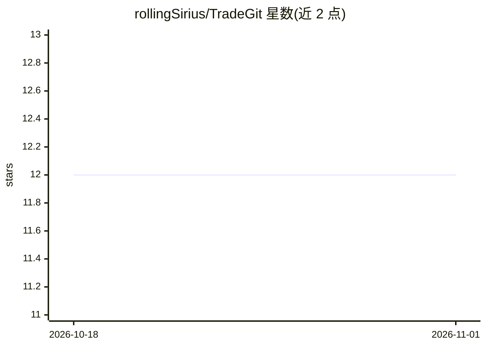

# rollingSirius/TradeGit

⭐ 12 · Python · MIT · 推送 2026-07-28 · [GitHub](https://github.com/rollingSirius/TradeGit) · 个人维护 · 中文 README

**交易日志 agent 技能：一句话记账、导流水、FIFO 算盈亏，数据自持**

面向实际交易者的交易日志 skill 与 CLI：在 Claude / Codex / Workbuddy 中用自然语言记录交易及理由、止损、信心度等字段；导入券商 CSV/JSON 流水（幂等、不绑定券商）；按 FIFO 确定性规则计算已实现盈亏、胜率、最大回撤等指标，生成 Markdown/PDF 复盘报告。数据存于 GitHub 私有仓库（init 拒绝非 private）或本地 git，记录只追加留痕。仅依赖 python3 与 git，不下单、不给投资建议。

## 筛选速览

| 维度 | 判定 | 备注 |
|---|---|---|
| AI 角色 | `ai-ecosystem` | LLM/agent 周边工具 |
| 许可风险 | `permissive` | MIT |
| 部署形态 | `None` |  |
| 模型依赖 | locked-api |  |
| 硬件要求 | — | 无带数字的原话,不猜 |
| 安装摩擦 | `low` | 无编译、无系统依赖或容器化 |
| 成熟度 | — | 结构信号不足 |

## 能力要点

- 自然语言记录交易及理由、止损/目标、信心度等一等字段
- 券商流水导入幂等去重，通用 CSV/JSON 均可
- FIFO 配对计算盈亏，含费用、部分平仓、仓位翻转与期权乘数
- GitHub 私有仓库或本地 git 存储，记录只追加、git log 全程留痕

## 适用场景

- 让 Claude/Codex 帮我随手记一笔交易和当时的理由
- 月底导入券商对账单，自动算清盈亏和复盘指标
- 季度复盘时看事实性观察（如亏损单平均持有天数）并写回错误归因

## 场景标签

`金融量化` · 领域:学习与行业

## 证据(README 行号)

> L92: |Claude Code / Desktop / claude.ai / Workbuddy|`~/.claude/skills/tradegit`|直接说「记一笔交易」|
> L386: SKILL.md              Claude / Workbuddy 入口（skill 定义）
> L387: AGENTS.md             Codex / Workbuddy 入口

## 星数曲线

2026-10-18 12 → 2026-11-01 12（+0）

---
*卡片 v1 · prompt 1.4 · 生成 2026-11-01 · 置信度 high · 依据 README sha `bc211f57ab87` · [字段定义](../../DATASET.md)*
