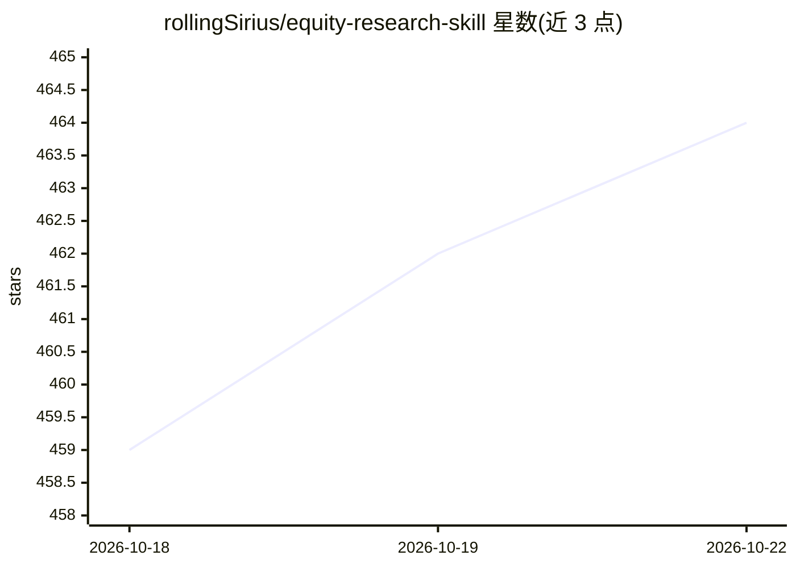

# rollingSirius/equity-research-skill

⭐ 464 · Python · MIT · 推送 2026-08-21 · [GitHub](https://github.com/rollingSirius/equity-research-skill) · [官网](https://x.com/rollingSirius) · 个人维护 · 中文 README

**供 AI 工具使用的个股深度研究技能包，产出可溯源估值报告**

面向支持 skills/agent 指令的 AI 工具（如 Claude Code/Desktop）的股票研究技能包。引导 AI 按机构研究流程输出九章节个股深度报告或财报深度报告：估值须由 scripts/dcf.py 等脚本执行（DCF/反向 DCF/EPV/EVA/SOTP，假设存档为 JSON），估值前先做盈利质量审查（应计质量、Beneish M-Score，输出 A–D 可信度等级），结论映射预登记的校准规则；内置 20 个行业附录与数据来源优先级。覆盖美股、港股、A 股。提供 git clone 与 Release 上传两种安装方式。

## 筛选速览

| 维度 | 判定 | 备注 |
|---|---|---|
| AI 角色 | `ai-ecosystem` | LLM/agent 周边工具 |
| 许可风险 | `permissive` | MIT |
| 部署形态 | `None` |  |
| 模型依赖 | locked-api |  |
| 硬件要求 | — | 无带数字的原话,不猜 |
| 安装摩擦 | `low` | 无编译、无系统依赖或容器化 |
| 成熟度 | — | 结构信号不足 |

## 能力要点

- 九章节深度报告与财报深度报告两种模式
- 估值由脚本执行（DCF/反向 DCF/EPV/EVA/SOTP），假设以 JSON 存档可复现
- 盈利质量审查（Sloan 应计、Beneish M-Score）输出 A–D 等级，C/D 等级触发否决
- 20 个行业附录按需加载，覆盖美股/港股/A 股

## 适用场景

- 让 AI 按机构研究流程产出单只股票的深度报告
- 财报发布后让 AI 生成九章节的财报深度分析
- 用脚本化 DCF/EPV/EVA 得到可复现的估值结论

## 场景标签

 · 领域:金融/投资研究

## 证据(README 行号)

> L13: The goal of this skill is not to generate a few paragraphs of stock summary, but to make AI tools follow something 
> L141: Copy this repo link and send it to any AI tool that supports skills or agent instructions:

## 星数曲线

2026-10-18 459 → 2026-10-22 464（+5）

---
*卡片 v1 · prompt 1.4 · 生成 2026-10-21 · 置信度 high · 依据 README sha `38cb17716bad` · [字段定义](../../DATASET.md)*
