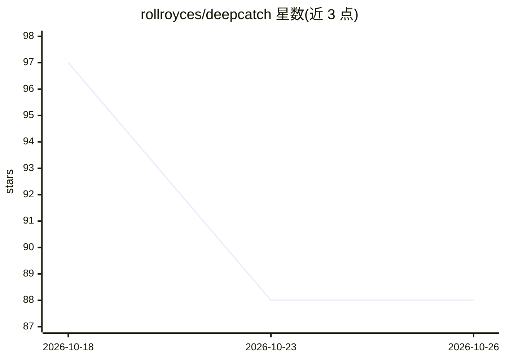

# rollroyces/deepcatch

⭐ 88 · Python · MIT · 推送 2026-10-17 · [GitHub](https://github.com/rollroyces/deepcatch) · 个人维护

**cfDNA 多模态癌症早检研究基准框架，仅供方法学研究**

从血浆游离 DNA（cfDNA）测序数据出发的多癌早检（MCED）计算框架：将 DELFI 片段长度比值、末端基序、核酸体定位等 5 通道片段组学特征融合为每样本约 70 维向量，再做跨研究 OOF 检测；另含 TCGA 突变 informed 检测面板、Transformer 基础模型与贝叶斯 Kalman 纵向随访的 CET 两阶段架构（后者仅在合成数据上验证）。README 明确声明仅限方法学研究、非临床验证、非医疗器械，并提供 GC 校正、真混杂对照等去批次评估。以 Python 包 + CLI + FastAPI 服务形式提供，附 Docker 与复现脚本。

## 筛选速览

| 维度 | 判定 | 备注 |
|---|---|---|
| AI 角色 | `ai-native` | 本体是模型或模型工具 |
| 许可风险 | `permissive` | MIT |
| 部署形态 | `self-host` | docker 或自建部署 |
| 模型依赖 | — | README 未给出锁定关系 |
| 硬件要求 | — | 无带数字的原话,不猜 |
| 安装摩擦 | `low` | 无编译、无系统依赖或容器化 |
| 成熟度 | `idea` | |

## 能力要点

- 5 通道片段组学特征融合（DELFI/MFS/核酸体/末端基序等）
- 跨研究 OOF 基准：GC 校正后 pooled AUC 0.967 ± 0.0035（n=627）
- 两项独立混杂对照（shuffled-null、true-confound collapse ~0.50）
- CET 两阶段架构（Transformer 融合 + Kalman 纵向），合成数据上验证

## 适用场景

- 在公开 cfDNA 数据上复现跨研究癌症检测基准
- 评估片段组学 + 突变通道融合的检测性能
- 研究纵向采样下的超早期检测方法（合成数据）

## 场景标签

 · 领域:生物信息学/癌症检测

## 证据(README 行号)

> L16: **DeepCatch** is an open-source computational framework for multi-cancer early detection (MCED) from cell-free DNA 
> L52: - **Multi-modal fragmentomics** — DELFI (5Mb / 100kb bin ratios), MFS, nucleosome positioning, FSD histograms, THEM
> L54: - **Honest confound controls** — true-confound control (cancer=study A, healthy=study B) collapses to ~0.50 under p

## 星数曲线

2026-10-18 97 → 2026-10-26 88（-9）

---
*卡片 v1 · prompt 1.4 · 生成 2026-10-23 · 置信度 high · 依据 README sha `ce2e6fce8f4f` · [字段定义](../../DATASET.md)*
