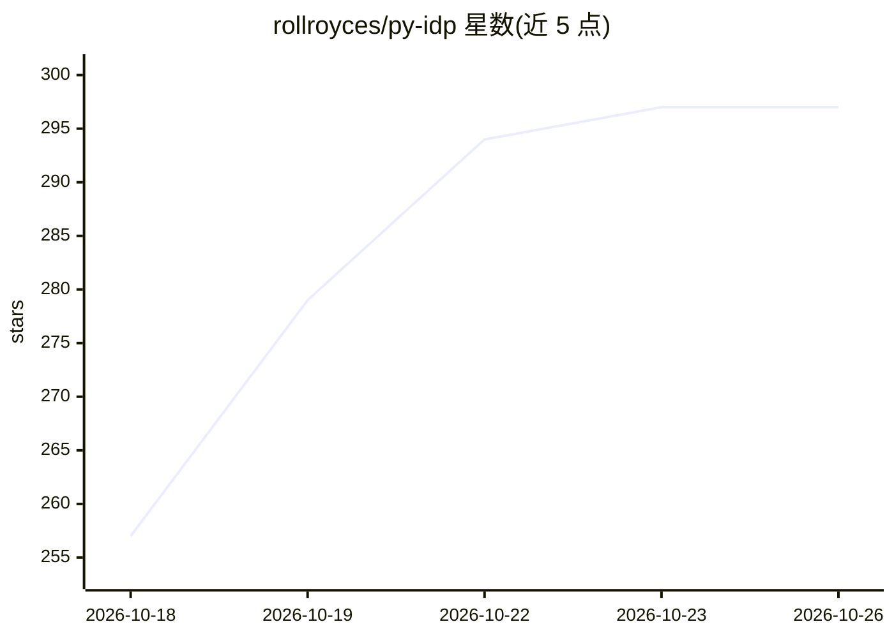

# rollroyces/py-idp

⭐ 297 · Python · NOASSERTION · 推送 2026-10-23 · [GitHub](https://github.com/rollroyces/py-idp) · [官网](https://pypi.org/project/py-idp/) · 个人维护 · 中文 README

**Python 智能文档处理框架：六阶段流水线完成文档解析与结构化抽取**

面向开发者的文档处理库，提供 parse→classify→extract→assess→validate→HITL 六阶段流水线，以 Pydantic schema 驱动结构化抽取，含置信度评估、低置信字段人工复核（Streamlit UI）与评测框架（field F1/schema-valid rate）。通过统一 Backend 协议接入 23 个 LLM 后端（OpenAI/Anthropic/DeepSeek/通义等国际与国内厂商，及 Ollama/vLLM 本地运行时），并支持 Nanonets-OCR2-3B、Unlimited-OCR 自托管离线 OCR。核心安装无需 API key（内置 mock 后端），AGPL-3.0 另提供商业许可。

## 筛选速览

| 维度 | 判定 | 备注 |
|---|---|---|
| AI 角色 | `ai-ecosystem` | LLM/agent 周边工具 |
| 许可风险 | `dual` | NOASSERTION |
| 部署形态 | `self-host` | docker 或自建部署 |
| 模型依赖 | local-ok | 支持本地模型 |
| 硬件要求 | — | 无带数字的原话,不猜 |
| 安装摩擦 | `low` | 无编译、无系统依赖或容器化 |
| 成熟度 | — | 结构信号不足 |

## 能力要点

- 六阶段流水线，每阶段为可独立替换的纯函数
- 23 个 LLM 后端走统一 Backend 协议，含 8 家国内厂商与 Ollama/vLLM 本地后端
- Nanonets-OCR2-3B / Unlimited-OCR 自托管 OCR，离线运行无云出站
- discover_schema() 从提示词与样本文档自动发现 schema；idp eval 输出 field F1 评测

## 适用场景

- 从发票、合同等 PDF 中抽取结构化字段并做 schema 校验
- 低置信字段路由到 HITL 人工复核并持久化修正
- 敏感文档在本地用自托管 OCR 离线处理

## 场景标签

`文档解析` · 领域:知识与检索

## 证据(README 行号)

> L8: > Six-stage pipeline (parse → classify → extract → assess → validate → HITL).
> L9: > 23 LLM backends. Pydantic-schema-driven. Built-in eval harness.
> L152: `py-idp` has a single `Backend` protocol and every provider implements it. The pipeline never sees provider-specif

## 星数曲线

2026-10-18 257 → 2026-10-26 297（+40）

---
*卡片 v1 · prompt 1.4 · 生成 2026-10-21 · 置信度 mid · 依据 README sha `1e17c4b77c19` · [字段定义](../../DATASET.md)*
