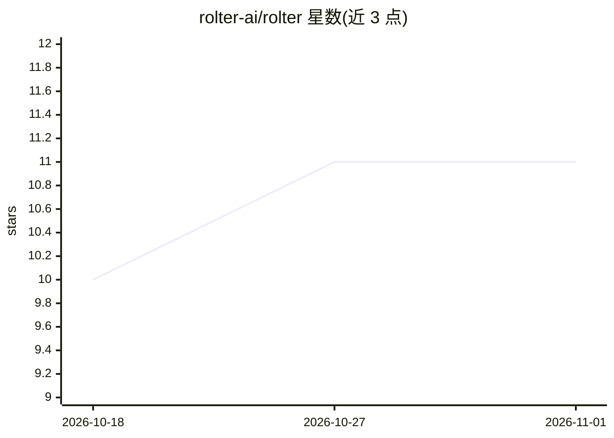

# rolter-ai/rolter

⭐ 11 · Rust · Apache-2.0 · 推送 2026-10-31 · [GitHub](https://github.com/rolter-ai/rolter) · [官网](https://rolter-ai.github.io/rolter/) · 组织维护

**Rust 编写的 OpenAI/Anthropic 兼容 AI 网关与负载均衡器**

面向需要统一接入多家商业模型服务商并管理自托管推理集群（如 20–30 个 vLLM 实例）的团队：以 Rust 数据平面（Axum/Hyper/Tower on Tokio）转发 OpenAI/Anthropic API 流量，提供 KV 缓存感知的负载均衡、虚拟密钥、预算与速率限制、RBAC、成本用量追踪和免重载配置。控制面使用 Postgres 存储，可配合 Redis 与 ClickHouse，自带 dashboard UI。README 自述处于活跃开发中（WIP），Rust 库 crate 不承诺稳定 API。

## 筛选速览

| 维度 | 判定 | 备注 |
|---|---|---|
| AI 角色 | `ai-ecosystem` | LLM/agent 周边工具 |
| 许可风险 | `permissive` | Apache-2.0 |
| 部署形态 | `self-host` | docker 或自建部署 |
| 模型依赖 | local-ok | 支持本地模型 |
| 硬件要求 | — | 无带数字的原话,不猜 |
| 安装摩擦 | `low` | 无编译、无系统依赖或容器化 |
| 成熟度 | `idea` | |

## 能力要点

- 缓存感知负载均衡：将前缀密集流量路由到 KV 缓存更热的 vLLM 副本
- 兼容 OpenAI 与 Anthropic API，客户端可原样接入
- 虚拟密钥、预算、速率限制、成本追踪与 RBAC
- 单镜像 Docker 启动，内置 fake-llm 模型可无 key 首跑

## 适用场景

- 统一网关接入多家商业模型服务商并控制成本与权限
- 为多实例 vLLM 自托管集群做负载均衡与缓存感知路由
- 团队共享的 LLM 流量管理与用量审计

## 场景标签

`模型网关` · 领域:Agent 开发

## 证据(README 行号)

> L19: rolter proxies commercial providers and load-balances self-hosted OpenAI-compatible fleets (e.g. 20–30 vLLM instanc
> L26: - **Cache-aware load balancing** — route prefix-heavy traffic to the vLLM replica most likely to have the KV cache 

## 星数曲线

2026-10-18 10 → 2026-11-01 11（+1）

---
*卡片 v1 · prompt 1.4 · 生成 2026-11-01 · 置信度 mid · 依据 README sha `dcd92c9f6734` · [字段定义](../../DATASET.md)*
