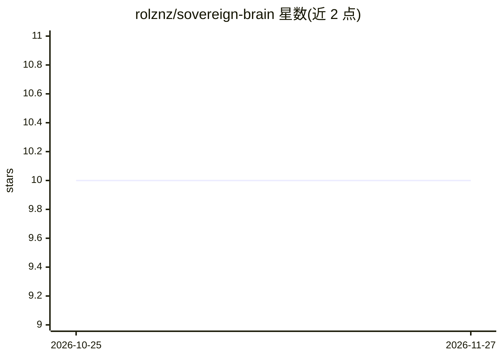

# rolznz/sovereign-brain

⭐ 10 · Unlicense · 推送 2026-07-19 · [GitHub](https://github.com/rolznz/sovereign-brain) · [官网](https://sovereignbrain.me) · 个人维护

**本地私密的第二大脑：用 markdown 文件夹 + 本地 LLM agent 做头脑风暴与决策**

以一个 markdown 文件夹为载体的个人"第二大脑"：AGENTS.md 定义助手人格 Atlas，随使用生成 thoughts、todos、项目想法等数据文件，整个文件夹可用 git 版本管理与备份。不绑定特定 agent 框架，任何支持 AGENTS.md 的 agent harness 配合本地模型即可运行。限制：非单一可执行程序，需自备本地 LLM 与 agent harness；推荐 32GB 内存，低配机器可用更小的 27B 模型；建议在一次性 VM 中沙箱运行 agent。

## 筛选速览

| 维度 | 判定 | 备注 |
|---|---|---|
| AI 角色 | `ai-native` | 本体是模型或模型工具 |
| 许可风险 | `permissive` | Unlicense |
| 部署形态 | `None` |  |
| 模型依赖 | local-ok | 支持本地模型 |
| 硬件要求 | `cpu-ok` | |
| 安装摩擦 | `medium` | 含编译或系统依赖之一 |
| 成熟度 | — | 结构信号不足 |

## 能力要点

- harness-independent：纯 markdown 文件夹，可对接任意支持 AGENTS.md 的 agent
- 数据即文件夹：全部内容可用 git 版本管理与备份
- 提供两档本地模型方案（35B A3B 量化版 / 1-bit 27B，最低 8GB 内存）
- 可选技能扩展：习惯追踪、头脑风暴、语音输入、钱包支付等

## 适用场景

- 在本地私密环境下做头脑风暴和个人项目推进
- 把脑中的想法倾倒到可版本管理的个人知识库
- 低配笔记本上用小型量化模型维持可用的助手

## 场景标签

`知识库管理` `AI 助手` · 领域:对话与助手

## 证据(README 行号)

> L3: A sovereign "second brain" for brainstorming, decision making, working on
> L11: It's **harness-independent**: just a folder of markdown. Point any agent that
> L29: - A local LLM — e.g. llama.cpp serving

## 星数曲线

2026-10-25 10 → 2026-11-27 10（+0）

---
*卡片 v1 · prompt 1.4 · 生成 2026-11-19 · 置信度 high · 依据 README sha `a49c3f11eb25` · [字段定义](../../DATASET.md)*
