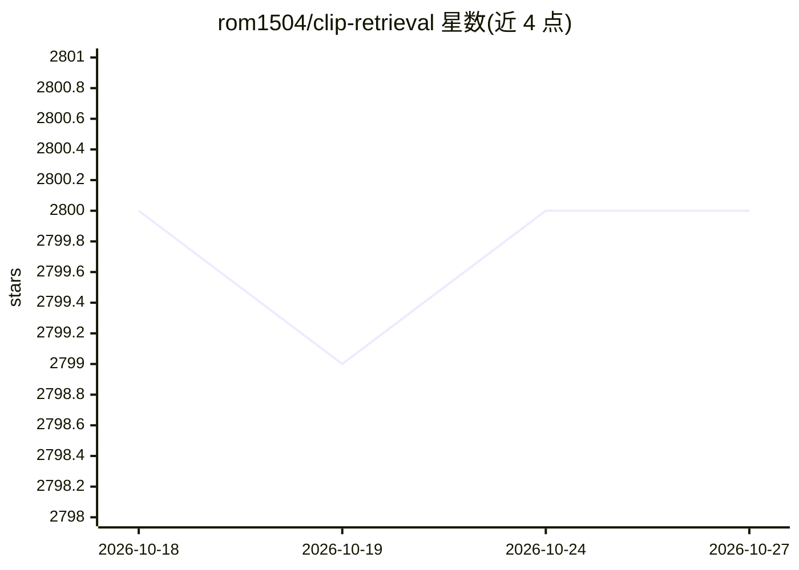

# rom1504/clip-retrieval

⭐ 2,800 · Jupyter Notebook · MIT · 推送 2026-03-28 · [GitHub](https://github.com/rom1504/clip-retrieval) · [官网](https://rom1504.github.io/clip-retrieval/) · 个人维护

**计算 CLIP 嵌入并构建图文语义检索系统的工具集**

由 rom1504 维护的多模块工具集：clip inference 以约 1500 sample/s（3080）计算图像与文本 CLIP 嵌入，clip index 构建高效索引，clip back 提供 Flask 后端服务，clip front 提供查询界面，clip client 支持用 Python 远程查询后端（文本/图像/嵌入查询），clip end2end 串联 img2dataset、推理、索引与前后端一键运行。支持 open_clip、HuggingFace CLIP、MCLIP 多语模型及 DeepSparse CPU 推理后端，可扩展至亿级样本，支持 Slurm 分布式。面向需要构建大规模图文语义检索或数据集增强的开发者。

## 筛选速览

| 维度 | 判定 | 备注 |
|---|---|---|
| AI 角色 | `ai-native` | 本体是模型或模型工具 |
| 许可风险 | `permissive` | MIT |
| 部署形态 | `library` | 以包/库形式分发 |
| 模型依赖 | — | README 未给出锁定关系 |
| 硬件要求 | — | 无带数字的原话,不猜 |
| 安装摩擦 | `low` | 无编译、无系统依赖或容器化 |
| 成熟度 | — | 结构信号不足 |

## 能力要点

- 图像/文本 CLIP 嵌入批量计算，支持 webdataset 输入与 Slurm 分布式
- ClipClient 支持按文本、图像、嵌入远程查询索引（如 Laion5B）
- end2end 命令串联下载、推理、索引与前后端服务
- 可选 open_clip / HuggingFace / MCLIP 多语模型与 DeepSparse CPU 后端

## 适用场景

- 为自己的图像数据集构建文本搜图的语义检索系统
- 查询 Laion5B 等托管索引以寻找相似图文对
- 批量计算数百万图文样本的 CLIP 嵌入并建索引

## 场景标签

`语义搜索` `多模态` · 领域:知识与检索

## 证据(README 行号)

> L8: Easily compute clip embeddings and build a clip retrieval system with them. 100M text+image embeddings can be proces
> L11: * clip inference allows you to quickly (1500 sample/s on a 3080) compute image and text embeddings
> L164: clip_inference turn a set of text+image into clip embeddings

## 星数曲线

2026-10-18 2,800 → 2026-10-27 2,800（+0）

---
*卡片 v1 · prompt 1.4 · 生成 2026-10-21 · 置信度 high · 依据 README sha `b8906b7c5aae` · [字段定义](../../DATASET.md)*
