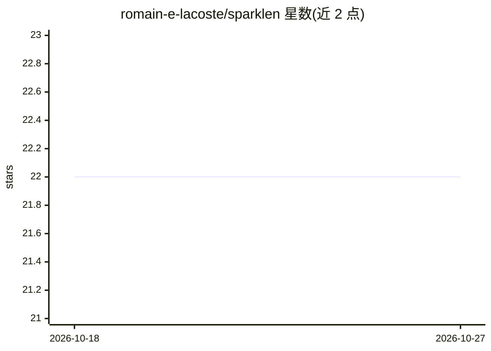

# romain-e-lacoste/sparklen

⭐ 22 · Python · BSD-3-Clause · 推送 2026-10-25 · [GitHub](https://github.com/romain-e-lacoste/sparklen) · [官网](https://arxiv.org/pdf/2502.18979) · 个人维护

**高维 Hawkes 过程的 Python 统计学习工具包**

面向指数核 Hawkes 过程的统计学习工具包，聚焦高维框架，提供基于簇结构的事件模拟方法、多元 Hawkes 过程的推断框架（含极大似然与经验风险最小化、正则化）以及监督学习框架下的多分类方法。计算密集部分使用 C++ 核心，通过 SWIG 与 Python 绑定。可用 pip 安装或从源码构建（源码构建需先安装 SWIG）。有配套 arXiv 论文可引用。

## 筛选速览

| 维度 | 判定 | 备注 |
|---|---|---|
| AI 角色 | `ai-native` | 本体是模型或模型工具 |
| 许可风险 | `permissive` | BSD-3-Clause |
| 部署形态 | `library` | 以包/库形式分发 |
| 模型依赖 | — | README 未给出锁定关系 |
| 硬件要求 | — | 无带数字的原话,不猜 |
| 安装摩擦 | `low` | 无编译、无系统依赖或容器化 |
| 成熟度 | — | 结构信号不足 |

## 能力要点

- 基于簇结构的高效事件模拟方法
- 多元 Hawkes 过程的推断框架（极大似然/正则化）
- 监督学习框架下的多分类方法
- C++ 核心 + SWIG 绑定

## 适用场景

- 对高维事件序列数据做 Hawkes 过程参数估计
- 模拟生成 Hawkes 过程事件数据
- 在监督学习框架下做事件多分类分析

## 场景标签

 · 领域:统计学习/点过程

## 证据(README 行号)

> L13: The purpose of `Sparklen` package is to provide the `Python` community with
> L15: the study of exponential Hawkes processes, with a particular focus
> L20:  * A highly versatile and flexible framework for performing inference of

## 星数曲线

2026-10-18 22 → 2026-10-27 22（+0）

---
*卡片 v1 · prompt 1.4 · 生成 2026-10-27 · 置信度 high · 依据 README sha `b11b7b5d101e` · [字段定义](../../DATASET.md)*
