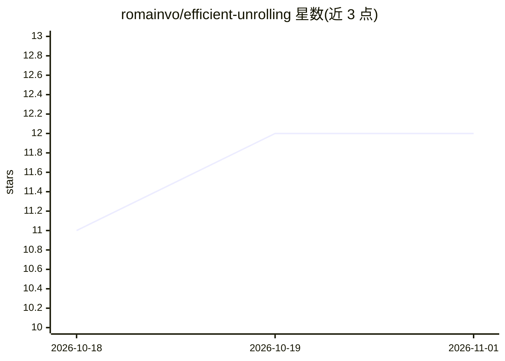

# romainvo/efficient-unrolling

⭐ 12 · Jupyter Notebook · 推送 2026-06-23 · [GitHub](https://github.com/romainvo/efficient-unrolling) · [官网](https://romainvo.github.io/efficient-unrolling/) · 个人维护

**面向科研者的3D大规模逆问题展开网络训练与重建代码**

CVPR 2026 论文 'Efficient Unrolling for Large Scale 3D Inverse Problems' 的官方代码库，基于 DeepInverse 库扩展，提供 PartitionedReconstructor（将全局逆问题分块为重叠子问题、保持3D物理前向模型）与 DiagCirculantWrapper（用数据拟合的对角-循环算子近似昂贵的法向算子 AᵀA）两个核心组件。支持 MRI（Calgary-Campinas）与 CBCT（Walnut）两类数据的训练与近似拟合脚本，通过 conda 安装依赖，附带 walnut 演示 notebook，数据与权重可从 Hugging Face 即时拉取。

## 筛选速览

| 维度 | 判定 | 备注 |
|---|---|---|
| AI 角色 | `ai-native` | 本体是模型或模型工具 |
| 许可风险 | `none` | — |
| 部署形态 | `None` |  |
| 模型依赖 | — | README 未给出锁定关系 |
| 硬件要求 | — | 无带数字的原话,不猜 |
| 安装摩擦 | `low` | 无编译、无系统依赖或容器化 |
| 成熟度 | — | 结构信号不足 |

## 能力要点

- PartitionedReconstructor 将全局3D逆问题分解为重叠 patch 子问题，保持与前向模型一致
- DiagCirculantWrapper 支持实/复值信号的2D与3D对角-循环算子近似
- 提供 MRI 与 CBCT 的端到端训练与近似拟合脚本，YAML 配置驱动
- 自包含 notebook 演示，数据权重从 Hugging Face 即时拉取

## 适用场景

- 在临床分辨率下训练3D MRI/CBCT 展开重建网络
- 为大规模逆问题拟合对角-循环算子近似以降低计算开销
- 复现论文实验或基于 DeepInverse 扩展自己的重建方法

## 场景标签

`科研工具` · 领域:学习与行业

## 证据(README 行号)

> L7: This repository contains the official code for the paper: **Efficient Unrolled Networks for Large Scale 3D Inverse P
> L9: We extend the DeepInverse library with a `PartitionedReconstructor` and `DiagCirculantWrapper` features to make *3D 

## 星数曲线

2026-10-18 11 → 2026-11-01 12（+1）

---
*卡片 v1 · prompt 1.4 · 生成 2026-11-01 · 置信度 high · 依据 README sha `dff1046ee1c7` · [字段定义](../../DATASET.md)*
