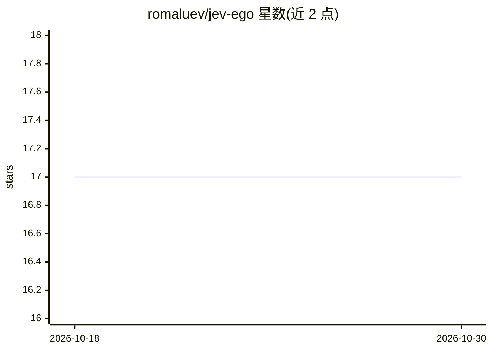

# romaluev/jev-ego

⭐ 17 · TypeScript · NOASSERTION · 推送 2026-09-17 · [GitHub](https://github.com/romaluev/jev-ego) · 个人维护

**驱动 ego lite 浏览器的 TypeScript agent，供编码 agent 操控网页**

面向本机 agent 与 harness 的浏览器 agent：将页面读取为编号元素表，由编码 agent 或 TypeSafe Jev 在 CLICK/TYPE_TEXT/SELECT 等操作中选择，每次决策仅一次网络往返；TypeSafe、文本助手与 CDP 运行于单个 ego-browser Node 进程。提供 serve/observe/act/step/run 等 CLI 命令与库形式调用。要求 macOS、ego lite、Node 20+ 与 pnpm，需 TypeSafe API key；不支持 shadow DOM、iframe、上传、canvas 等，明示为 MVP。

## 筛选速览

| 维度 | 判定 | 备注 |
|---|---|---|
| AI 角色 | `ai-ecosystem` | LLM/agent 周边工具 |
| 许可风险 | `none` | NOASSERTION |
| 部署形态 | `library` | 以包/库形式分发 |
| 模型依赖 | — | README 未给出锁定关系 |
| 硬件要求 | — | 无带数字的原话,不猜 |
| 安装摩擦 | `low` | 无编译、无系统依赖或容器化 |
| 成熟度 | `idea` | |

## 能力要点

- 编号元素表 + 8 种操作的动作空间，模型输出不落为选择器/坐标/JS
- TypeSafe/文本助手/CDP 单进程运行，无 Python 与 Browser Harness
- serve 守护进程复用 TaskSpace，observe/act/step 免进程启动开销
- 提供 CLI 命令与库形式（Agent/EgoBrowser 类）两种使用方式

## 适用场景

- 让本机编码 agent 通过自然语言目标操控网页
- 在 ego lite 上跑浏览器自动化任务（如 Google Flights 查询演示）
- 作为库嵌入 ego-browser Node 脚本实现自定义 agent 循环

## 场景标签

`浏览器自动化` · 领域:效率与自动化

## 证据(README 行号)

> L5: Give it one natural-language goal. A coding agent (or TypeSafe Jev) picks `CLICK` / `TYPE_TEXT` / `SELECT` on a numb
> L7: **Who it's for.** Every local agent and harness on this machine. Default browser is ego lite through `jev-ego`. Not 

## 星数曲线

2026-10-18 17 → 2026-10-30 17（+0）

---
*卡片 v1 · prompt 1.4 · 生成 2026-10-29 · 置信度 mid · 依据 README sha `62df1d97a80b` · [字段定义](../../DATASET.md)*
