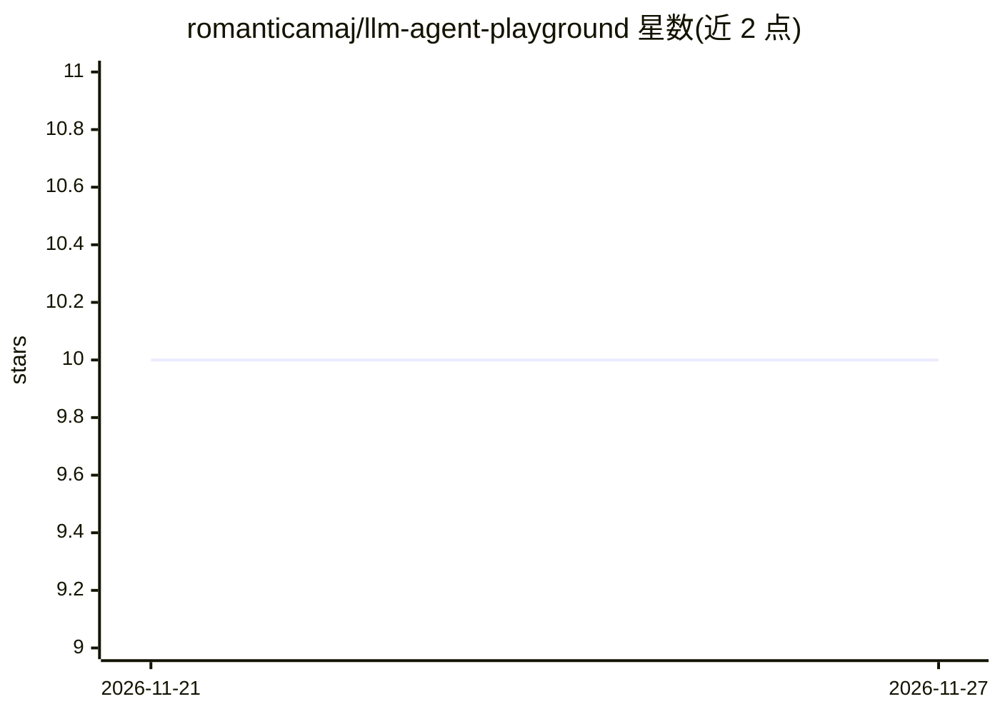

# romanticamaj/llm-agent-playground

⭐ 10 · JavaScript · MIT · 推送 2026-09-23 · [GitHub](https://github.com/romanticamaj/llm-agent-playground) · [官网](https://www.garyhsieh.com/ai-lab) · 个人维护 · 中文 README

**给 AI 学习者/讲师的互动式 LLM/Agent 概念教学实验室**

将作者文章与课堂内容转化为可运行的互动教学网站：九章 44 个概念，每个概念对应一支手写 vanilla JS 互動 demo，全部本地模拟、不调用任何 API。项目自带 DemoStage「导演式分镜」框架（beats 分镜、spotlight 视线引导、字幕旁白、sandbox 收尾）、概念 Markdown 单一内容源构建流水线，以及投影上课用的简报模式（P/K 键切换）。代码 MIT 授权，教学内容版权归作者保留。安装通过 npm 在 site 目录下 install/dev 运行。

## 筛选速览

| 维度 | 判定 | 备注 |
|---|---|---|
| AI 角色 | `ai-knowledge` | 知识聚合/清单类 |
| 许可风险 | `permissive` | MIT |
| 部署形态 | `library` | 以包/库形式分发 |
| 模型依赖 | — | README 未给出锁定关系 |
| 硬件要求 | — | 无带数字的原话,不猜 |
| 安装摩擦 | `low` | 无编译、无系统依赖或容器化 |
| 成熟度 | — | 结构信号不足 |

## 能力要点

- 44 个概念各配一支本地模拟的互动 demo，不调用任何 API
- DemoStage 导演式分镜框架：一次只教一件事、最后一拍开放自由实验
- concepts/*.md 为唯一内容来源，build script 自动生成网站数据
- 内建投影简报模式与概念目录快捷键

## 适用场景

- 给团队/客户讲授 LLM 与 Agent 基础概念时投影上课
- 想亲手玩一遍 context window、tool use、multi-agent 等概念
- 参考其骨架搭建自己的互动教学站（内容自写）

## 场景标签

`教程课程` · 领域:学习与行业

## 证据(README 行号)

> L1: An interactive lab for AI/LLM/agent concepts — every concept ships with a hand-built, directed demo you can play wit
> L7: 把 garyhsieh.com 的 AI 心得文章，做成一座**可以親手玩的教學實驗室** —— 九章、44 個概念，從 LLM 的本質一路走到 Agent 工程，每一個概念都有自己的互動 demo。
> L17: - **每個概念都是一個可玩的 demo，不是一張圖。** 每一個概念都對應一支手寫的 vanilla JS 互動模組（`site/src/demos/`），全部本地模擬、不打任何 API。文字接龍、貨車 compaction、c

## 星数曲线

2026-11-21 10 → 2026-11-27 10（+0）

---
*卡片 v1 · prompt 1.4 · 生成 2026-11-21 · 置信度 high · 依据 README sha `8011d26f1b59` · [字段定义](../../DATASET.md)*
