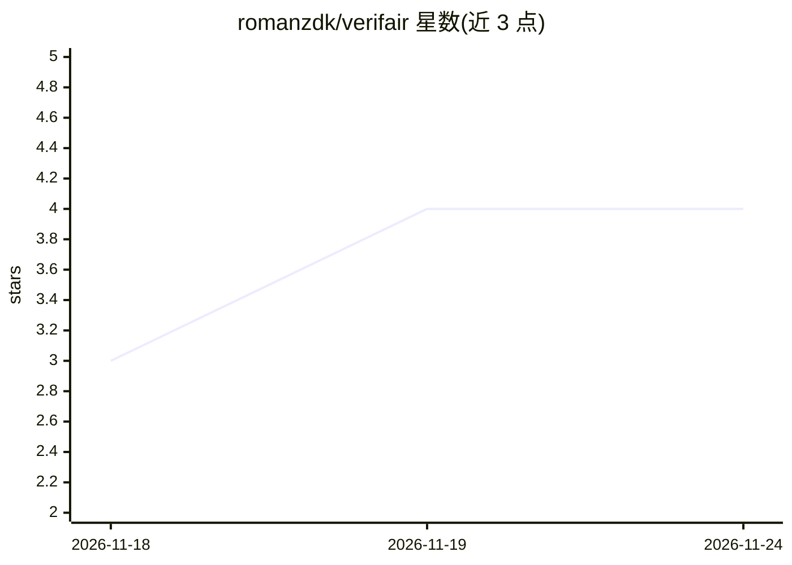

# romanzdk/verifair

⭐ 4 · Python · MIT · 推送 2026-11-20 · [GitHub](https://github.com/romanzdk/verifair) · [官网](https://romanzdk.github.io/verifair/) · 个人维护

**自托管的编码 agent 变更报告人工评审平台**

verifair 是一个自托管 Web 服务：编码 agent 通过 JSON API 推送 markdown 变更评审报告，人阅读报告、选中文字评论并给出批准/修改裁决，形成多版本签核与评审循环。服务本身不运行 AI（README 明确说明），agent 在用户机器或 CI 上运行。技术栈为 FastAPI、Jinja、htmx 与 Postgres，支持本地模式与带登录的共享模式，内置 agent 技能一键安装与 Slack 通知。

## 筛选速览

| 维度 | 判定 | 备注 |
|---|---|---|
| AI 角色 | `ai-ecosystem` | LLM/agent 周边工具 |
| 许可风险 | `permissive` | MIT |
| 部署形态 | `self-host` | docker 或自建部署 |
| 模型依赖 | — | README 未给出锁定关系 |
| 硬件要求 | — | 无带数字的原话,不猜 |
| 安装摩擦 | `low` | 无编译、无系统依赖或容器化 |
| 成熟度 | — | 结构信号不足 |

## 能力要点

- agent 推送结构化变更报告，人工签核后团队再评审，裁决按版本保存
- 选中任意文字开评论线程，默认阻塞批准，支持 Conventional Comments 标签
- Prompt coaching：队友可直接在评审页评论作者提示词，Claude Code/Codex/OpenCode 会话自动导出
- 提供 JSON API、长轮询反馈与 npx skills 一键安装的 agent 技能

## 适用场景

- 团队让 coding agent 写代码后由人评审报告再决定是否合并
- 为 agent 产出的变更留存签核、评论与批准的完整流程记录
- 通过共享模式给团队成员分配评审并接入 OIDC 登录

## 场景标签

`代码审查` · 领域:编码与开发

## 证据(README 行号)

> L3: **Review the evidence, not the diff.** A self-hosted place where coding agents publish change reports and people jud
> L48: verifair runs no AI itself. Coding agents run where they always do (your machine, CI) and use an agent token to pub

## 星数曲线

2026-11-18 3 → 2026-11-24 4（+1）

---
*卡片 v1 · prompt 1.4 · 生成 2026-11-21 · 置信度 high · 依据 README sha `cbd34a95c987` · [字段定义](../../DATASET.md)*
