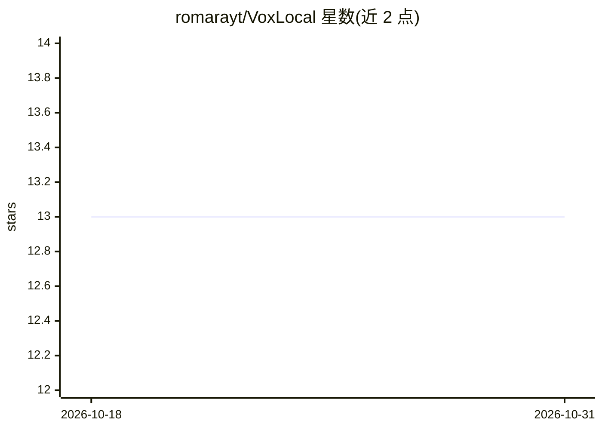

# romarayt/VoxLocal

⭐ 13 · Swift · MIT · 推送 2026-07-14 · [GitHub](https://github.com/romarayt/VoxLocal) · 个人维护

**macOS 全局语音听写应用：本地 whisper.cpp 转写，可选本地 Ollama 润色**

菜单栏形式的 macOS 语音听写工具：按住或切换全局快捷键录音，用内置 whisper.cpp（固定 v1.9.1，Apple Silicon 上 Metal 加速）在设备上转写，并将文本插入当前应用；可选接入本地 Ollama 服务做标点、大小写与填充词清理，Ollama 不可用时自动回退原始转写。隐私模型明确：无云端 API、无遥测，音频转写后立即删除，Ollama 仅允许 loopback 地址。需 Xcode 命令行工具从源码构建，支持俄语/英语界面与俄英转写。

## 筛选速览

| 维度 | 判定 | 备注 |
|---|---|---|
| AI 角色 | `ai-native` | 本体是模型或模型工具 |
| 许可风险 | `permissive` | MIT |
| 部署形态 | `None` |  |
| 模型依赖 | local-ok | 支持本地模型 |
| 硬件要求 | — | 无带数字的原话,不猜 |
| 安装摩擦 | `medium` | 含编译或系统依赖之一 |
| 成熟度 | — | 结构信号不足 |

## 能力要点

- whisper.cpp 本地转写，Apple Silicon 上 Metal 加速
- 可选本地 Ollama 文本润色，失败自动回退原始转写
- 全局快捷键 + 三级文本插入（Accessibility API / 模拟⌘V / 剪贴板）
- 无云端、无遥测、仅 loopback 网络访问的隐私模型

## 适用场景

- 在任意 macOS 应用中按快捷键语音输入文字
- 不依赖云服务的本地语音转写
- 对转写文本自动做标点和填充词清理

## 场景标签

`语音识别` · 领域:感知与多模态

## 证据(README 行号)

> L12: - **On-device transcription** with whisper.cpp (pinned to `v1.9.1`), Metal-accelerated on Apple Silicon. Russian, E
> L13: - **Optional text refinement** (punctuation, capitalization, filler-word cleanup) through a **local Ollama** server

## 星数曲线

2026-10-18 13 → 2026-10-31 13（+0）

---
*卡片 v1 · prompt 1.4 · 生成 2026-10-31 · 置信度 high · 依据 README sha `d64707c60efe` · [字段定义](../../DATASET.md)*
