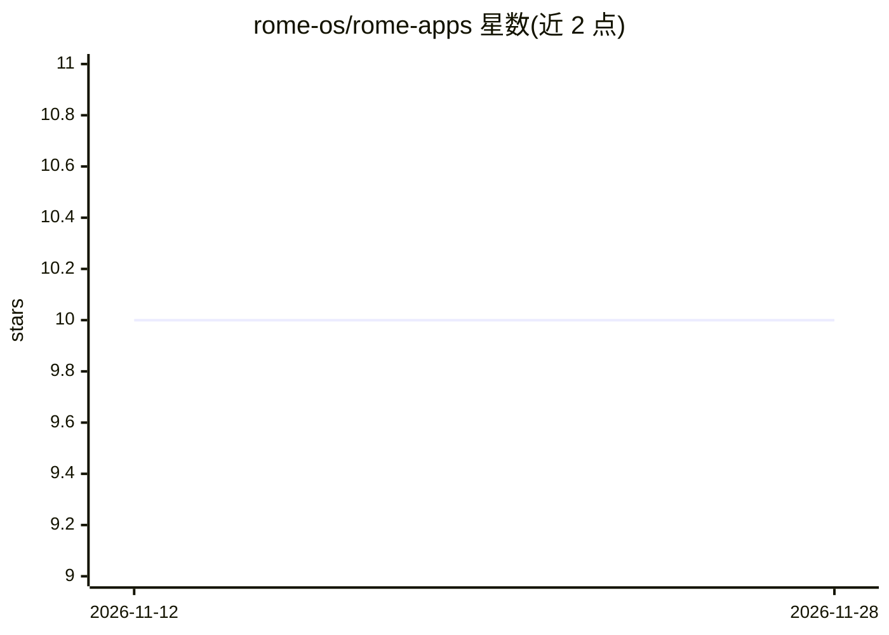

# rome-os/rome-apps

⭐ 10 · TypeScript · MIT · 推送 2026-11-26 · [GitHub](https://github.com/rome-os/rome-apps) · [官网](https://romeos.cc) · 组织维护

**面向 Rome 代理 OS 的一方可安装 AI 应用集合（monorepo）**

该仓库为 Rome OS（一个递归代理 OS）的第一方应用 monorepo，每个 apps/ 目录是带 app.yaml 清单的独立应用包，可组合类型化动作、专用 agent、可复用技能、API、Web 界面与应用自有数据。收录约 20 个应用，覆盖代码评审、公司研究、SEO、社媒管理、学习/教学、股票日报等场景。应用使用与社区开发者相同的公开契约，Rome 运行时在 rome-os/rome 仓库；开发需 Node.js 24.11.1+ 与 pnpm 10.33.2+，通过 App Store 安装发布版本。

## 筛选速览

| 维度 | 判定 | 备注 |
|---|---|---|
| AI 角色 | `ai-native` | 本体是模型或模型工具 |
| 许可风险 | `permissive` | MIT |
| 部署形态 | `library` | 以包/库形式分发 |
| 模型依赖 | — | README 未给出锁定关系 |
| 硬件要求 | — | 无带数字的原话,不猜 |
| 安装摩擦 | `low` | 无编译、无系统依赖或容器化 |
| 成熟度 | — | 结构信号不足 |

## 能力要点

- 每个应用为带 app.yaml 清单的独立安装包
- 应用组合动作、agent、技能、API、Web 界面与持久数据
- 提供约 20 个第一方应用（代码评审/研究/社媒/学习等）
- 提供 Rome App Store 浏览可安装发布版

## 适用场景

- 在 Rome OS 上安装官方应用执行代码评审、公司研究等任务
- 参考官方应用包结构开发自己的 Rome App
- 为团队沉淀社媒运营、SEO、新闻聚合等 agent 工作流

## 场景标签

`工作流自动化` `代码审查` · 领域:效率与自动化

## 证据(README 行号)

> L3:  Official apps for Rome, a compounding agent OS for recursive agents.
> L28: This monorepo contains Rome OS's first-party apps. A Rome App can combine typed actions, purpose-built agents, reus
> L36: |Brainstorm|Turns rough ideas into approved design specifications before implementation|

## 星数曲线

2026-11-12 10 → 2026-11-28 10（+0）

---
*卡片 v1 · prompt 1.4 · 生成 2026-11-19 · 置信度 mid · 依据 README sha `070c063cc886` · [字段定义](../../DATASET.md)*
