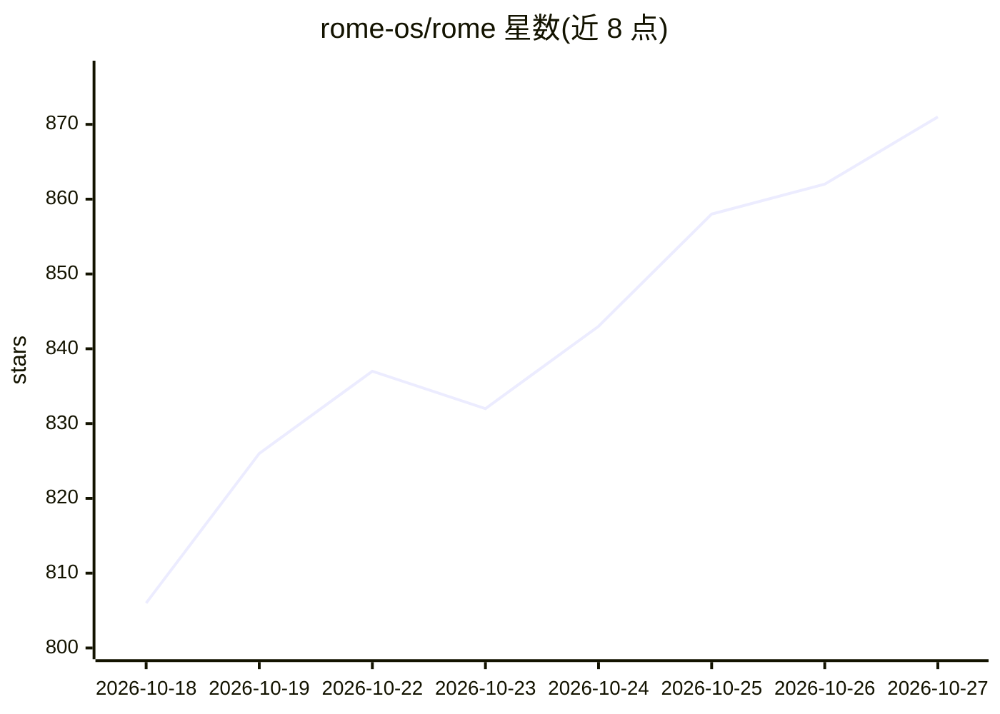

# rome-os/rome

⭐ 871 · TypeScript · MIT · 推送 2026-10-26 · [GitHub](https://github.com/rome-os/rome) · [官网](https://romeos.cc) · 组织维护

**自托管的个人 AI agent 操作系统，让 agent 持久执行任务并自建应用**

Rome 是一个面向递归 agent 的运行环境：在带护栏的环境中让人与 agent 协作，agent 可构建自己的 harness、SOP 并编排工作流，沉淀为可复用的能力。核心机制是 Rome App：以 app.yaml 清单组合 Actions、Agents、Skills、Hooks、Web UI 与持久数据，产物为 git 跟踪的源代码。支持自托管（Docker 一键脚本）或 Rome Cloud（预览），提供 App Store 分发。源码运行需 Node.js 24+、pnpm 与 Docker Compose。

## 筛选速览

| 维度 | 判定 | 备注 |
|---|---|---|
| AI 角色 | `ai-native` | 本体是模型或模型工具 |
| 许可风险 | `permissive` | MIT |
| 部署形态 | `self-host` | docker 或自建部署 |
| 模型依赖 | — | README 未给出锁定关系 |
| 硬件要求 | — | 无带数字的原话,不猜 |
| 安装摩擦 | `low` | 无编译、无系统依赖或容器化 |
| 成熟度 | `idea` | |

## 能力要点

- Rome App 将 agent 推理、可复用工作流与持久数据打包为可安装产物（app.yaml 清单 + 两套公开 SDK）
- 用自然语言描述需求即可生成规格并脚手架化 app/workflow，产物为 git 跟踪的普通源码
- 支持一次性任务、定时任务、长程跟进与 App Store 分发
- Docker 一键脚本自托管，dashboard 默认仅绑定 loopback，状态存于 named volumes

## 适用场景

- 让 agent 持续跟进代码评审、邮件分拣、价格追踪等重复性工作
- 用对话让 agent 为自己定制带持久数据的小应用
- 自托管个人 agent 环境并按需选择模型提供方

## 场景标签

`Agent 框架` `工作流自动化` `AI 助手` · 领域:Agent 开发

## 证据(README 行号)

> L9:  A compounding agent OS for recursive agents.
> L36: Rome is a guardrailed environment where human and agent collaborate, and the collaboration compounds. Agents build 
> L126: A Rome App combines a purpose-built interface, agent reasoning, reusable

## 星数曲线

2026-10-18 806 → 2026-10-27 871（+65）

---
*卡片 v1 · prompt 1.4 · 生成 2026-10-21 · 置信度 mid · 依据 README sha `44d54662551d` · [字段定义](../../DATASET.md)*
