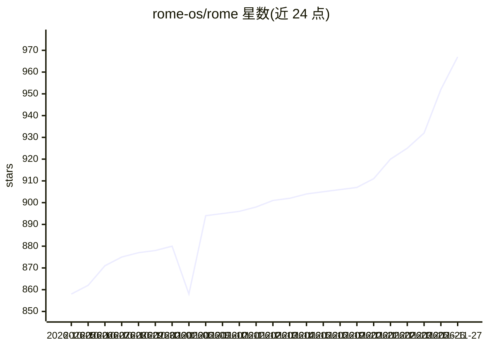

# rome-os/rome

⭐ 967 · TypeScript · MIT · 推送 2026-11-26 · [GitHub](https://github.com/rome-os/rome) · [官网](https://romeos.cc) · 组织维护

**自托管的个人 AI agent 操作系统，支持持久代理与定时任务**

Rome 是一个为持久化 agent 设计的自托管运行环境：agent 在带护栏的环境中与用户协作，沉淀 skills、actions、应用与私有数据（git 跟踪的代码形态），并提供定时任务、长时跟进与专用 App 界面，而非单一聊天窗口。用户可用自然语言让 Rome 生成并迭代新的 app 或 workflow。通过 Docker 快速脚本自托管，也提供 Rome Cloud 预览与 Mac 客户端（客户端不运行本体）。开发路径需 Node.js 24、pnpm。

## 筛选速览

| 维度 | 判定 | 备注 |
|---|---|---|
| AI 角色 | `ai-ecosystem` | LLM/agent 周边工具 |
| 许可风险 | `permissive` | MIT |
| 部署形态 | `self-host` | docker 或自建部署 |
| 模型依赖 | — | README 未给出锁定关系 |
| 硬件要求 | — | 无带数字的原话,不猜 |
| 安装摩擦 | `low` | 无编译、无系统依赖或容器化 |
| 成熟度 | — | 结构信号不足 |

## 能力要点

- 以 Docker 脚本自托管，仪表盘默认仅绑定 loopback
- Rome App 由 app.yaml 清单组合 actions/agents/skills/hooks/数据库
- 自然语言生成 git 跟踪的 app 源码并支持 App Store 分发
- 支持 Telegram、Discord、WhatsApp 聊天渠道接入

## 适用场景

- 让 agent 持续跟进代码评审等重复性工作
- 自动整理邮箱并起草回复
- 按计划监控商品价格并通知
- 自托管一个可累积能力的个人 agent 环境

## 场景标签

`AI 助手` `工作流自动化` · 领域:效率与自动化

## 证据(README 行号)

> L9:  A compounding agent OS for recursive agents.
> L36: Rome is a guardrailed environment where human and agent collaborate, and the collaboration compounds. Agents build 
> L222: |**Rome**|Actions, skills, and apps as git-tracked code, plus memory and app-private data|Saved actions, with mode

## 星数曲线

2026-10-25 858 → 2026-11-27 967（+109）

---
*卡片 v1 · prompt 1.4 · 生成 2026-11-25 · 置信度 high · 依据 README sha `677a8cf39992` · [字段定义](../../DATASET.md)*
