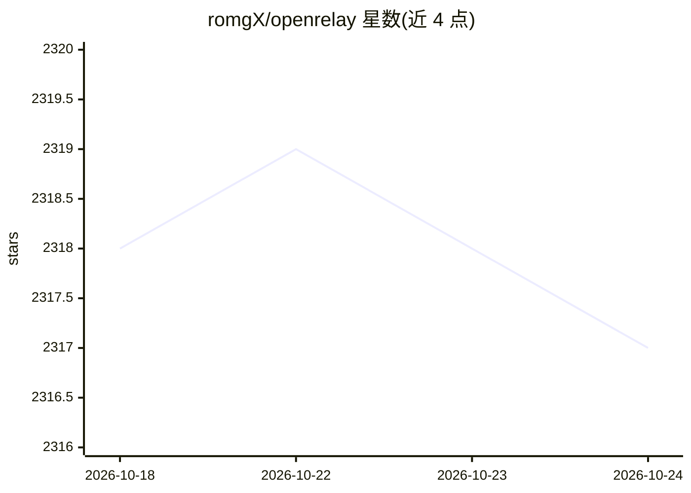

# romgX/openrelay

⭐ 2,317 · TypeScript · MIT · 推送 2026-10-20 · [GitHub](https://github.com/romgX/openrelay) · 组织维护 · 中文 README

**本地 AI 配额聚合网关：统一接入订阅与免费配额供各工具使用**

运行于本机的 AI 配额聚合与代理工具：自动发现本机已有 AI 来源（Claude Desktop、Kiro、Windsurf、Copilot 等 13 个本地/CLI Provider），并支持 45 个直连 API 或本地端点（Groq、DeepSeek、OpenRouter、Ollama 等），共 58 个非虚拟 Provider，通过本地端点 localhost:18765 以 Anthropic/OpenAI 兼容 API 形式供 Claude Code、Aider、Goose 等 CLI 工具调用；另提供 Cursor/Windsurf 的 RPC 代理与 Copilot 的 Ollama BYOK 桥接、多 Provider 虚拟模型组与自动故障转移。以预编译可执行文件分发，Web 面板管理，凭据存本机，采用 Open Core 模式。

## 筛选速览

| 维度 | 判定 | 备注 |
|---|---|---|
| AI 角色 | `ai-ecosystem` | LLM/agent 周边工具 |
| 许可风险 | `permissive` | MIT |
| 部署形态 | `desktop` | 安装包/桌面程序 |
| 模型依赖 | local-ok | 支持本地模型 |
| 硬件要求 | — | 无带数字的原话,不猜 |
| 安装摩擦 | `low` | 无编译、无系统依赖或容器化 |
| 成熟度 | — | 结构信号不足 |

## 能力要点

- 聚合 58 个非虚拟 Provider（13 个本地会话来源 + 45 个 API/本地端点）
- 一键为 Claude Code、Aider、Goose、OpenCode 等 CLI 工具切换配额来源
- Cursor/Windsurf RPC 代理与 VS Code Copilot 的 Ollama BYOK 桥接
- 多 Provider 合并为虚拟模型组，支持轮询与自动故障转移

## 适用场景

- 把 Claude Pro 或 Kiro 等订阅配额用到 Claude Code、Aider 等其他工具
- Cursor/Windsurf 额度耗尽后切换到其他配额来源继续编码
- 合并 Groq/Cerebras/SambaNova 等免费配额组成带故障转移的虚拟模型

## 场景标签

`模型网关` · 领域:Agent 开发

## 证据(README 行号)

> L5:  聚合本机与直连 AI 配额，一键接入本地项目
> L44: 支持 45 个直连 API 或本地端点（Groq、Gemini API、DeepSeek、Mistral、OpenRouter、LongCat、千帆、七牛、Anthropic API、Ollama 等）— 按供应商要求配置 API
> L54: $env:ANTHROPIC_BASE_URL="http://localhost:18765"

## 星数曲线

2026-10-18 2,318 → 2026-10-24 2,317（-1）

---
*卡片 v1 · prompt 1.4 · 生成 2026-10-21 · 置信度 mid · 依据 README sha `e035218e816f` · [字段定义](../../DATASET.md)*
