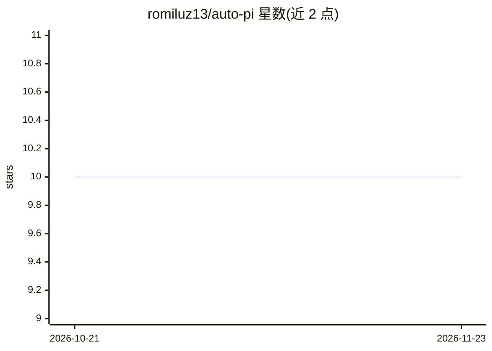

# romiluz13/auto-pi

⭐ 10 · TypeScript · MIT · 推送 2026-08-16 · [GitHub](https://github.com/romiluz13/auto-pi) · 个人维护

**给 Pi 编码代理装工作流编排层的配置包**

面向 Pi 编码代理的可安装配置：通过 extensions、prompts、skills 与共享 AGENTS.md，在 Pi 的最小 harness 之上叠加四层结构——Coach 固定菜单、带类型化状态机的工作流解释器、ask-matt 路由、procedure 层。用户输入任务后选择 /plan、/build、/debug 等 8 种工作流，解释器持久化哈希链状态、拒绝非法状态转移、分阶段全新派发，仅在难以回退的决策处中断用户。依赖 Pi 0.84.1+、Node、npm、git、mise、jq、gitleaks，模型按 Pi 可达范围自选。

## 筛选速览

| 维度 | 判定 | 备注 |
|---|---|---|
| AI 角色 | `ai-ecosystem` | LLM/agent 周边工具 |
| 许可风险 | `permissive` | MIT |
| 部署形态 | `None` |  |
| 模型依赖 | — | README 未给出锁定关系 |
| 硬件要求 | — | 无带数字的原话,不猜 |
| 安装摩擦 | `low` | 无编译、无系统依赖或容器化 |
| 成熟度 | — | 结构信号不足 |

## 能力要点

- 8 个固定入口工作流（/plan /build /debug /research /review /ship /triage /setup-audit）
- 类型化工作流状态机 + 哈希链持久化日志与派发 outbox
- ask-matt 路由以 SHA-256 漂移校验固定来源
- 仓库内 14 个专家技能 + 社区包，目录共 88+ 技能

## 适用场景

- 在 Pi 中用固定流程跑完规划到发布的自主编码任务
- 给编码代理加持久化状态与可恢复的工作流运行
- 复用同一份 AGENTS.md 规则到 Pi、Claude Code 与 Codex

## 场景标签

`编码 Agent` · 领域:编码与开发

## 证据(README 行号)

> L6: Not another coding agent. A dress on Pi's minimal harness: Coach, PTM-authenticated workflow goals, ask-matt as the 
> L15: |An installable Pi config: extensions + prompts + skills + shared `AGENTS.md`|A sealed product competing with Claud
> L19: ## Install

## 星数曲线

2026-10-21 10 → 2026-11-23 10（+0）

---
*卡片 v1 · prompt 1.4 · 生成 2026-11-19 · 置信度 high · 依据 README sha `2648d44f4419` · [字段定义](../../DATASET.md)*
