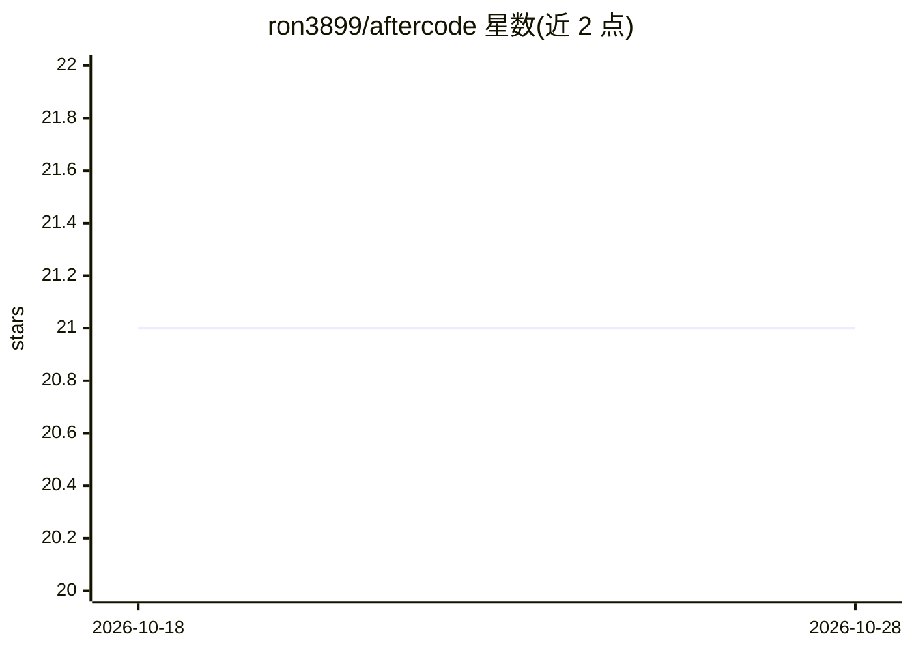

# ron3899/aftercode

⭐ 21 · Rust · NOASSERTION · 推送 2026-09-09 · [GitHub](https://github.com/ron3899/aftercode) · 个人维护

**把 AI 编程会话转成双语播客的自托管工具**

Rust CLI + API 后端 + React Web UI 的自托管应用：自动检测 Claude Code / Codex / Cursor 的本地会话记录与 git diff，用 LLM 提炼技术主题并生成两主播播客脚本，经 TTS（ElevenLabs/OpenAI）合成音频，在网页播放列表中浏览收听，支持英语和希伯来语，附主题筛选、要点与测验。LLM 供应商在 trait 后可插拔，上传前有密钥正则脱敏与 preview 预览；目前为单用户构建，正式 OAuth/多用户在 Phase 3 计划中。标准安装仅需 Docker 运行后端镜像并安装 CLI 预编译二进制。

## 筛选速览

| 维度 | 判定 | 备注 |
|---|---|---|
| AI 角色 | `ai-native` | 本体是模型或模型工具 |
| 许可风险 | `permissive` | NOASSERTION |
| 部署形态 | `self-host` | docker 或自建部署 |
| 模型依赖 | — | README 未给出锁定关系 |
| 硬件要求 | — | 无带数字的原话,不猜 |
| 安装摩擦 | `low` | 无编译、无系统依赖或容器化 |
| 成熟度 | — | 结构信号不足 |

## 能力要点

- 自动检测 Claude Code / Codex / Cursor 会话 + git diff 生成播客
- LLM（Anthropic/OpenAI/mock）与 TTS（ElevenLabs/OpenAI/mock）供应商可插拔，支持无 key 的 mock 模式
- Docker 镜像后端 + 预编译 CLI，无需 clone 与编译
- 上传前正则脱敏密钥，aftercode preview 可查看将发送的内容

## 适用场景

- 把每天的 AI 结对编程会话变成复习用的播客
- 通勤时收听当天代码背后的技术概念讲解
- 在网页播放列表中按主题、语言筛选和回放往期节目

## 场景标签

`语音合成` `AI 写作` · 领域:内容生成

## 证据(README 行号)

> L5: **Turn your daily AI coding sessions into personalized learning podcasts.**
> L7: Aftercode connects to your coding-agent workflow (Claude Code, Codex, Cursor, …), figures out the deeper technical t

## 星数曲线

2026-10-18 21 → 2026-10-28 21（+0）

---
*卡片 v1 · prompt 1.4 · 生成 2026-10-28 · 置信度 mid · 依据 README sha `4e251b05b560` · [字段定义](../../DATASET.md)*
