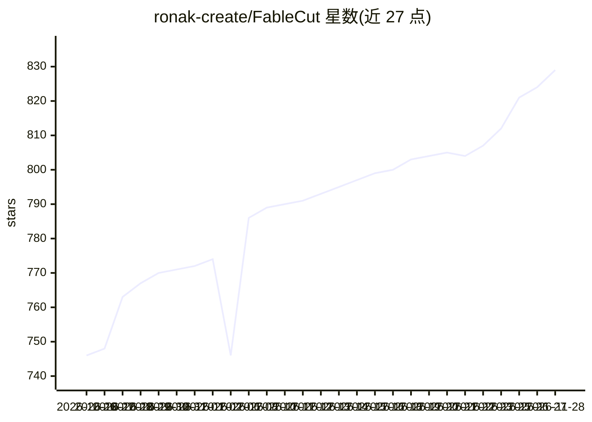

# ronak-create/FableCut

⭐ 829 · JavaScript · MIT · 推送 2026-11-27 · [GitHub](https://github.com/ronak-create/FableCut) · [官网](fablecut.space) · 个人维护 · 中文 README

**浏览器内视频编辑器：AI agent 可通过 JSON/MCP 驱动剪辑**

运行于浏览器的非线性的 Premiere 风格视频编辑器，将整个时间线暴露为一个 project.json 文档，可通过 UI 手工编辑或由支持 MCP/REST 的 AI agent（如 Claude Code、Claude Desktop）代为剪辑，浏览器 UI 经 server-sent events 热更新。功能覆盖多轨剪辑、音频混音与特效、转场、降噪（经 ffmpeg）、Reframe、字幕、语音转录（浏览器内 Whisper）等。零 npm 依赖，一条 node server.js 启动。每个 agent 编辑作为独立撤销步骤，并自动保留版本。

## 筛选速览

| 维度 | 判定 | 备注 |
|---|---|---|
| AI 角色 | `ai-enhanced` | 去掉 AI 部分产品仍成立 |
| 许可风险 | `permissive` | MIT |
| 部署形态 | `library` | 以包/库形式分发 |
| 模型依赖 | — | README 未给出锁定关系 |
| 硬件要求 | — | 无带数字的原话,不猜 |
| 安装摩擦 | `medium` | 含编译或系统依赖之一 |
| 成熟度 | — | 结构信号不足 |

## 能力要点

- project.json 即接口：任何能写 JSON 的进程都可编辑视频，UI ~150ms 热更新
- 提供 fablecut_* MCP 工具（patch/auto_duck/silence/beats/clips 等）供 agent 调用
- agent 编辑独立成撤销步骤并自动存版本，可对比与恢复
- 浏览器内 Whisper 转录与词级时间戳的文字剪辑

## 适用场景

- 让 AI agent 帮我剪短视频/reel，我在时间线上实时查看
- 把长播客一键切成多条竖屏字幕短片发 TikTok/Shorts
- 文字转录驱动的访谈剪辑：找到一句话并删除所有出现处
- 人机同时编辑同一条时间线协作剪片

## 场景标签

`语音识别` `图像视频处理` · 领域:感知与多模态

## 证据(README 行号)

> L3: **A browser video editor that AI agents can drive.**
> L20: FableCut is a Premiere-style non-linear video editor that runs entirely in your
> L22: from the UI, or let an AI agent (Claude Code, Claude Desktop, or anything that

## 星数曲线

2026-10-26 746 → 2026-11-28 829（+83）

---
*卡片 v1 · prompt 1.4 · 生成 2026-11-28 · 置信度 mid · 依据 README sha `361e6bd544e4` · [字段定义](../../DATASET.md)*
