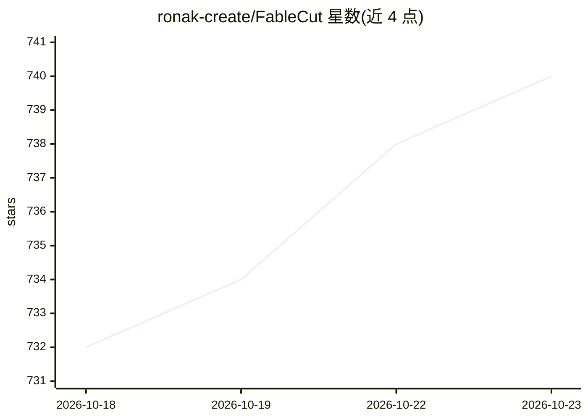

# ronak-create/FableCut

⭐ 740 · JavaScript · MIT · 推送 2026-10-22 · [GitHub](https://github.com/ronak-create/FableCut) · [官网](fablecut.space) · 个人维护 · 中文 README

**浏览器非线性视频编辑器，可由 AI agent 经 MCP/REST 驱动剪辑**

零 npm 依赖的 Premiere 风格浏览器非线性视频编辑器，通过 node server.js 启动。整个时间线以单个 project.json 描述（媒体、片段、轨道、效果、关键帧、转场），任何能写 JSON 的进程都可编辑视频，浏览器 UI 经 SSE 在约 150ms 内热重载，人与 agent 可同时操作同一时间线。功能覆盖多轨视频/音频剪辑、混音器与音频效果、自动闪避、降噪（ffmpeg）、代理剪辑、多序列与版本历史等。面向希望通过 MCP/REST 接口驱动视频剪辑的开发者与创作者。

## 筛选速览

| 维度 | 判定 | 备注 |
|---|---|---|
| AI 角色 | `ai-enhanced` | 去掉 AI 部分产品仍成立 |
| 许可风险 | `permissive` | MIT |
| 部署形态 | `library` | 以包/库形式分发 |
| 模型依赖 | — | README 未给出锁定关系 |
| 硬件要求 | — | 无带数字的原话,不猜 |
| 安装摩擦 | `medium` | 含编译或系统依赖之一 |
| 成熟度 | — | 结构信号不足 |

## 能力要点

- 时间线即单个 project.json，任何能写 JSON 的进程都可剪辑
- MCP/REST 接口供 Claude 等 AI agent 驱动编辑（如 fablecut_auto_duck、fablecut_denoise）
- 零 npm 依赖，一条 node server.js 即可运行
- 多轨剪辑、混音器、音频效果链、自动闪避、代理剪辑与版本历史

## 适用场景

- 让 Claude Code 等 agent 通过对话自动完成视频剪辑
- 人工与 AI 在同一时间线上协作编辑，实时看到变更
- 制作 16:9 与 9:16 reels 等多格式多序列版本

## 场景标签

`图像视频处理` · 领域:感知与多模态

## 证据(README 行号)

> L3: **A browser video editor that AI agents can drive.**
> L22: from the UI, or let an AI agent (Claude Code, Claude Desktop, or anything that
> L26: Zero npm dependencies. One `node server.js`. That's it.

## 星数曲线

2026-10-18 732 → 2026-10-23 740（+8）

---
*卡片 v1 · prompt 1.4 · 生成 2026-10-21 · 置信度 mid · 依据 README sha `d8283c71ae14` · [字段定义](../../DATASET.md)*
