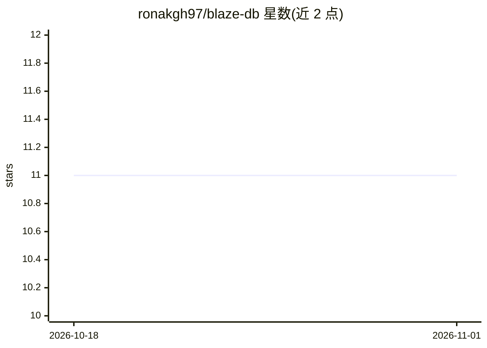

# ronakgh97/blaze-db

⭐ 11 · Rust · MIT · 推送 2026-06-16 · [GitHub](https://github.com/ronakgh97/blaze-db) · 个人维护

**Rust 编写的独立自管理向量数据库，HNSW 索引**

以 Rust 实现的独立向量数据库，以 blaze-server 与 blaze-client 两个二进制提供客户端/服务器模式，将 embedding 以二进制/JSON 存储于磁盘，基于 HNSW 图做近似最近邻检索，支持 Cosine/Euclidean/Dot Product 距离。机制包括内存映射文件、rayon 并行、LRU 索引缓存、临时文件加原子重命名的崩溃安全写入、tombstone 懒删除与后台重建索引。提供 Docker 镜像、CLI 与基准测试套件；README 的 TODO 列表显示多处功能仍在进行中。

## 筛选速览

| 维度 | 判定 | 备注 |
|---|---|---|
| AI 角色 | `ai-ecosystem` | LLM/agent 周边工具 |
| 许可风险 | `permissive` | MIT |
| 部署形态 | `self-host` | docker 或自建部署 |
| 模型依赖 | — | README 未给出锁定关系 |
| 硬件要求 | — | 无带数字的原话,不猜 |
| 安装摩擦 | `low` | 无编译、无系统依赖或容器化 |
| 成熟度 | `idea` | |

## 能力要点

- HNSW 近似最近邻索引，支持三种距离度量
- 磁盘存储 + 内存映射文件 + rayon 并行读取
- LRU 索引缓存与崩溃安全的原子写入
- 备份恢复、tombstone 懒删除与后台重建索引

## 适用场景

- 存储并检索 embedding 做相似度搜索
- 对预索引数据集（如 Amazon 商品）做语义查询
- 以客户端/服务器模式独立部署向量检索服务

## 场景标签

`向量数据库` · 领域:知识与检索

## 证据(README 行号)

> L7: Blaze-DB is a *reasonably* high-performance vector database designed for efficient hard disk-storage and fast retrie
> L17: - Implements HNSW (Hierarchical Navigable Small World) graph for approximate nearest neighbor search.

## 星数曲线

2026-10-18 11 → 2026-11-01 11（+0）

---
*卡片 v1 · prompt 1.4 · 生成 2026-11-01 · 置信度 high · 依据 README sha `1808fa788188` · [字段定义](../../DATASET.md)*
