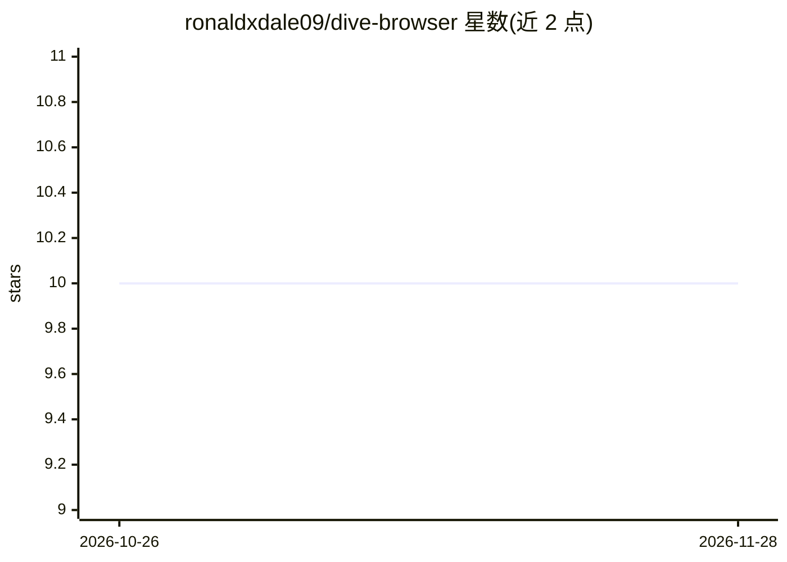

# ronaldxdale09/dive-browser

⭐ 10 · Rust · MIT · 推送 2026-11-22 · [GitHub](https://github.com/ronaldxdale09/dive-browser) · 个人维护

**面向开发者的 Chromium 浏览器：分页旁开发工具栏 + 可操作标签页的 Agent**

基于 Chromium Embedded Framework 的 macOS/Windows 原生浏览器，Rust 核心 + React 界面，键盘优先。页面旁内置 Network、Console、Storage、无障碍面板、设备模拟器与录屏工具；侧栏 AI Agent 可读取并操作当前标签页（读取页面、点击、输入、检查请求）。通过内置 MCP 服务（localhost:7391，bearer token 鉴权）让 Claude Code、Cursor 等 MCP 客户端打开标签、读页、截图。需自带各模型 API key，或用 Ollama/LM Studio 本地运行。提供 DMG 与安装包，也可从源码构建（Node 20+/pnpm/Rust/CMake）。

## 筛选速览

| 维度 | 判定 | 备注 |
|---|---|---|
| AI 角色 | `ai-enhanced` | 去掉 AI 部分产品仍成立 |
| 许可风险 | `permissive` | MIT |
| 部署形态 | `library` | 以包/库形式分发 |
| 模型依赖 | local-ok | 支持本地模型 |
| 硬件要求 | — | 无带数字的原话,不猜 |
| 安装摩擦 | `medium` | 含编译或系统依赖之一 |
| 成熟度 | — | 结构信号不足 |

## 能力要点

- 侧栏 Agent 可读取页面、点击、输入并检查请求，支持多模型 key 或 Ollama/LM Studio 本地运行
- 内置 MCP 服务，MCP 客户端可经 token 鉴权操作标签页、截图并跟踪 console/network
- 开发 dock：请求体、SSE/WebSocket 帧、HAR 导出、请求 mock、axe-core 无障碍审计、从流量推断 OpenAPI
- DivePrivacy 广告/追踪拦截与 DiveScreen 标签录屏（视频/GIF + 剪辑）

## 适用场景

- 在浏览器内调试网络请求、控制台与存储，无需切换 DevTools
- 让 Claude Code 或 Cursor 通过 MCP 直接读取和操作浏览器标签页
- 用本地模型驱动 Agent 读取页面并执行操作
- 录制并剪辑标签页操作生成产品演示

## 场景标签

`浏览器自动化` `AI 助手` · 领域:效率与自动化

## 证据(README 行号)

> L27: Dive is a native browser for macOS and Windows, built on the Chromium Embedded Framework, with a Rust core and a Re
> L31: - **An agent in the side panel.** It reads the page, clicks, types, inspects requests and reports back. Bring your 

## 星数曲线

2026-10-26 10 → 2026-11-28 10（+0）

---
*卡片 v1 · prompt 1.4 · 生成 2026-11-19 · 置信度 mid · 依据 README sha `2c74c61fcd36` · [字段定义](../../DATASET.md)*
