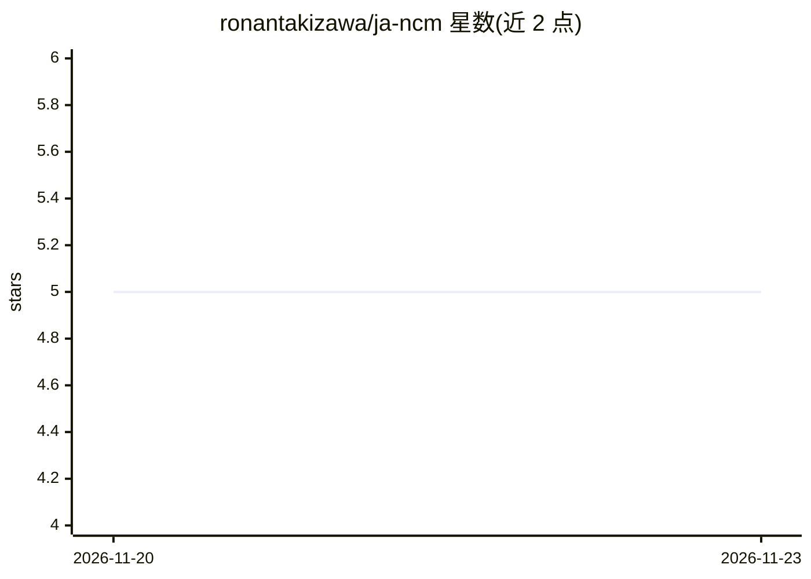

# ronantakizawa/ja-ncm

⭐ 5 · Python · NOASSERTION · 推送 2026-11-18 · [GitHub](https://github.com/ronantakizawa/ja-ncm) · [官网](https://huggingface.co/ronantakizawa/ja-ncm) · 个人维护

**为科研人员提供日语 Next-Concept 基础模型训练与评测代码**

从零训练日语 Next-Concept 基础模型（NCM）的完整训练代码库：包含多尺度残差 VQ-VAE 概念分词器、由粗到细逐级预测代码的 transformer 生成器，以及同预算的掩码扩散（MDLM）与自回归基线。补充了 HazyResearch 未开源的训练循环、数据准备、评测与延迟基准；同一流水线可迁移到其他语言。模型权重发布在 Hugging Face，论文见 arXiv。安装采用 venv 内 pip editable 安装，另提供 GPU Docker 镜像；全语料数据准备约需 400 GB 磁盘。

## 筛选速览

| 维度 | 判定 | 备注 |
|---|---|---|
| AI 角色 | `ai-native` | 本体是模型或模型工具 |
| 许可风险 | `none` | NOASSERTION |
| 部署形态 | `self-host` | docker 或自建部署 |
| 模型依赖 | — | README 未给出锁定关系 |
| 硬件要求 | — | 无带数字的原话,不猜 |
| 安装摩擦 | `low` | 无编译、无系统依赖或容器化 |
| 成熟度 | — | 结构信号不足 |

## 能力要点

- 概念分词器将 128-token 窗口压缩为 12 级离散代码，全文生成仅需 12 次前向
- 附带同预算 MDLM 扩散与自回归基线的对比训练与评测
- 支持 torchrun 多 GPU 数据并行训练，可通过 --resume auto 断点续训
- 提供针对其他语言复用流水线的分步配置说明

## 适用场景

- 复现 ja-NCM 的训练与评测结果
- 为新语言训练一个 NCM 模型
- 对比 NCM、扩散与自回归模型在相同预算下的质量与延迟

## 场景标签

`模型训练` `模型评测` `科研工具` · 领域:评测与运维

## 证据(README 行号)

> L1: # ja-NCM: A Japanese Next-Concept Foundation Model
> L3: Code I used train a Japanese Next-Concept Foundation Model from scratch, plus same-budget masked diffusion (MDLM) an
> L9: HazyResearch released NCM checkpoints and evaluation code but not training code. This repository adds the training l

## 星数曲线

2026-11-20 5 → 2026-11-23 5（+0）

---
*卡片 v1 · prompt 1.4 · 生成 2026-11-21 · 置信度 high · 依据 README sha `2cb2ee226f11` · [字段定义](../../DATASET.md)*
