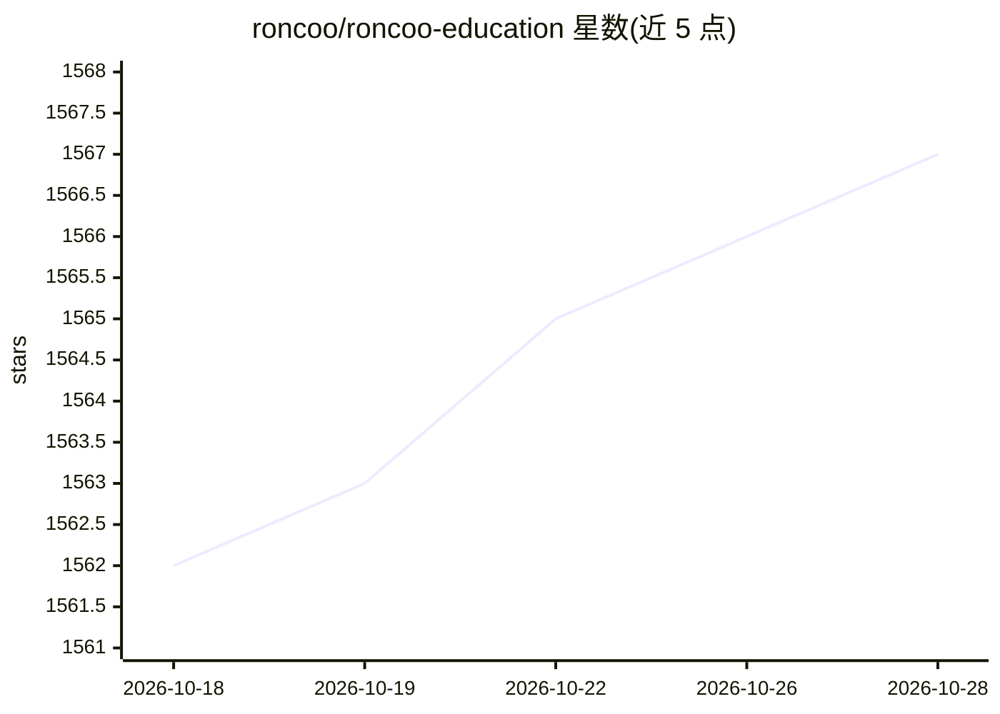

# roncoo/roncoo-education

⭐ 1,567 · Java · AGPL-3.0 · 推送 2026-10-13 · [GitHub](https://github.com/roncoo/roncoo-education) · [官网](https://www.roncoo.net) · 组织维护 · 中文 README

**前后端分离的分布式在线教育网校系统（点播/直播/考试）**

基于多年在线教育平台运营经验打造的开源网校系统：后端采用 Spring Cloud Alibaba 微服务架构（Nacos、Seata、MySQL8），前台与管理系统分别基于 Nuxt3 与 Vue3 + Element-Plus。功能覆盖课程点播（支持多家视频云接入）、课程附件管理（支持多家存储云接入）等，可帮助个人或企业搭建在线教育平台。目前集成 AI 写作能力，以流式输出实时生成课程简介、教学大纲等内容。开源版基于商业版精简实现，限个人学习、毕业设计等非商用用途，商用需联系咨询。

## 筛选速览

| 维度 | 判定 | 备注 |
|---|---|---|
| AI 角色 | `ai-enhanced` | 去掉 AI 部分产品仍成立 |
| 许可风险 | `viral` | AGPL-3.0 |
| 部署形态 | `None` |  |
| 模型依赖 | — | README 未给出锁定关系 |
| 硬件要求 | — | 无带数字的原话,不猜 |
| 安装摩擦 | `low` | 无编译、无系统依赖或容器化 |
| 成熟度 | `idea` | |

## 能力要点

- 课程点播支持多家视频云接入，附件管理支持多家存储云接入
- Spring Cloud Alibaba 微服务后端 + Vue3/Nuxt3 前后端分离
- 集成 AI 写作能力，流式输出生成课程简介与教学大纲

## 适用场景

- 搭建在线培训、远程教学或知识付费平台
- 个人学习、毕业设计或教学案例使用
- 借助 AI 快速生成课程简介与教学大纲等教育内容

## 场景标签

`AI 写作` · 领域:内容生成

## 证据(README 行号)

> L27: 领课教育系统（roncoo-education）是基于领课网络多年的在线教育平台开发和运营经验打造出来的产品，致力于打造一个各行业都适用的分布式在线教育系统。系统采用前后端分离模式，前台采用vue.js为核心框架，后台采用Spri
> L29: 目前集成AI写作能力，采用流式输出技术，实时生成课程简介、教学大纲等专业教育内容，显著提升课程内容生产效率和质量，我们会陆续添加更多AI能力，请持续关注。

## 星数曲线

2026-10-18 1,562 → 2026-10-28 1,567（+5）

---
*卡片 v1 · prompt 1.4 · 生成 2026-10-21 · 置信度 high · 依据 README sha `b773ecdb9182` · [字段定义](../../DATASET.md)*
