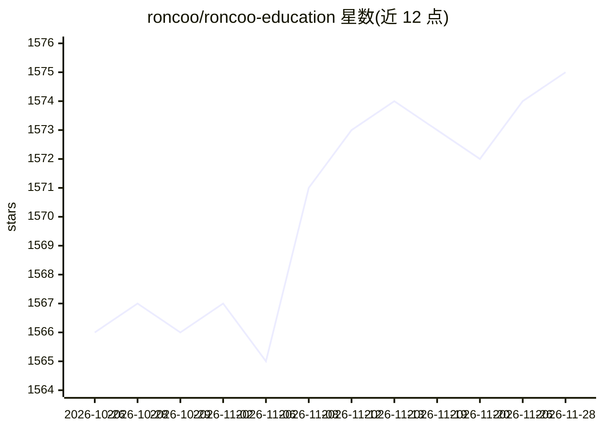

# roncoo/roncoo-education

⭐ 1,575 · Java · AGPL-3.0 · 推送 2026-11-23 · [GitHub](https://github.com/roncoo/roncoo-education) · [官网](https://www.roncoo.net) · 组织维护 · 中文 README

**面向个人和企业的开源在线教育/网校系统**

基于 Spring Cloud Alibaba 与 Vue 的前后端分离在线教育系统，提供课程点播、附件管理等功能，支持接入多家视频云与存储云。开源版为商业版的精简实现，可用于个人学习、毕业设计、教学案例与公益事业，商用需联系作者咨询。目前集成 AI 写作能力，以流式输出方式生成课程简介、教学大纲等内容，并表示会陆续添加更多 AI 能力。README 未给出具体安装步骤，另提供演示地址与三个子仓库（后端/门户/管理）。

## 筛选速览

| 维度 | 判定 | 备注 |
|---|---|---|
| AI 角色 | `ai-enhanced` | 去掉 AI 部分产品仍成立 |
| 许可风险 | `viral` | AGPL-3.0 |
| 部署形态 | `None` |  |
| 模型依赖 | — | README 未给出锁定关系 |
| 硬件要求 | — | 无带数字的原话,不猜 |
| 安装摩擦 | `low` | 无编译、无系统依赖或容器化 |
| 成熟度 | — | 结构信号不足 |

## 能力要点

- 前后端分离：Vue3/Nuxt3 前台 + Spring Cloud Alibaba 后台
- 课程点播支持多家视频云接入，附件管理支持多家存储云接入
- 集成 AI 写作能力，流式输出生成课程简介与教学大纲
- 提供门户、管理系统的在线演示地址

## 适用场景

- 为个人或企业快速搭建在线教育/网校平台
- 用作毕业设计或教学案例
- 搭建企业内部在线培训与知识付费系统

## 场景标签

`AI 写作` · 领域:内容生成

## 证据(README 行号)

> L27: 领课教育系统（roncoo-education）是基于领课网络多年的在线教育平台开发和运营经验打造出来的产品，致力于打造一个各行业都适用的分布式在线教育系统。系统采用前后端分离模式，前台采用vue.js为核心框架，后台采用Spri
> L29: 目前集成AI写作能力，采用流式输出技术，实时生成课程简介、教学大纲等专业教育内容，显著提升课程内容生产效率和质量，我们会陆续添加更多AI能力，请持续关注。

## 星数曲线

2026-10-26 1,566 → 2026-11-28 1,575（+9）

---
*卡片 v1 · prompt 1.4 · 生成 2026-11-23 · 置信度 high · 依据 README sha `692f95daa590` · [字段定义](../../DATASET.md)*
