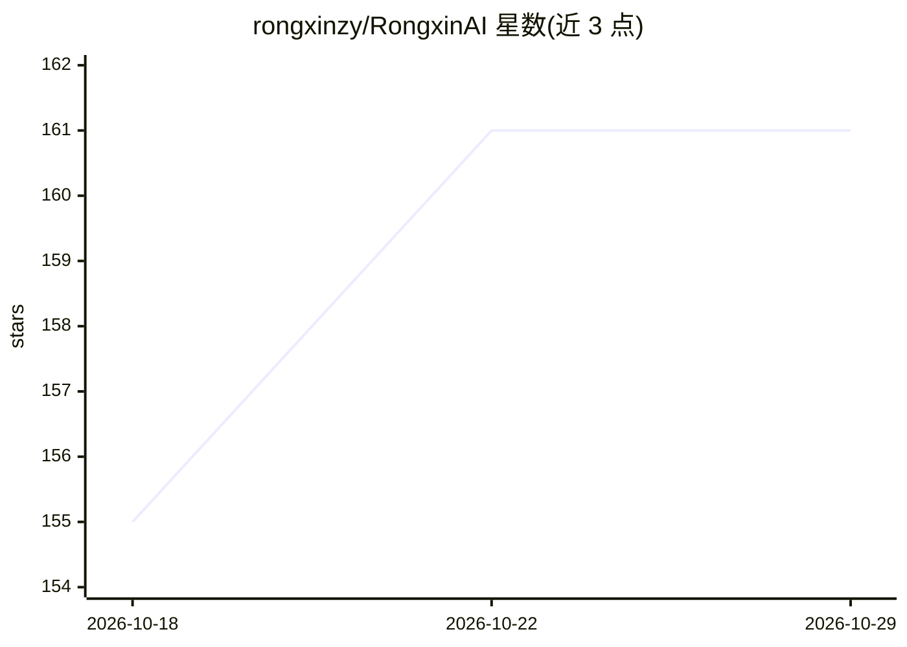

# rongxinzy/RongxinAI

⭐ 161 · TypeScript · AGPL-3.0 · 推送 2026-10-28 · [GitHub](https://github.com/rongxinzy/RongxinAI) · [官网](https://www.rongxzyai.com) · 组织维护 · 中文 README

**本地优先的开源桌面 AI 智能体，可从微信/飞书/钉钉派任务**

Electron 桌面 AI agent（ZhiYuan Agent）：内置免费模型可零 API key 起用（需联网，限额在应用内显示），也可经 llama.cpp 运行时从模型市场安装本地 GGUF 模型并调节上下文/GPU/线程。Agent 可读写文件、执行命令、经 Playwright 连接器操作浏览器，产出 PPT/Word/PDF/Excel；支持从微信、企业微信、钉钉、飞书、QQ、Telegram、Discord 及邮件通道派发任务，并支持 Experts/Skills/MCP 扩展与定时任务。会话与配置本地存储，工具执行有权限模式（默认 Allow all）。提供 Windows/macOS/Linux 安装包，AGPL-3.0 许可。

## 筛选速览

| 维度 | 判定 | 备注 |
|---|---|---|
| AI 角色 | `ai-native` | 本体是模型或模型工具 |
| 许可风险 | `viral` | AGPL-3.0 |
| 部署形态 | `desktop` | 安装包/桌面程序 |
| 模型依赖 | local-ok | 支持本地模型 |
| 硬件要求 | — | 无带数字的原话,不猜 |
| 安装摩擦 | `medium` | 含编译或系统依赖之一 |
| 成熟度 | — | 结构信号不足 |

## 能力要点

- 内置免费模型，无需第三方 API key 即可开始
- llama.cpp 运行本地 GGUF 模型，可调上下文/GPU/线程
- 从微信/飞书/钉钉等 IM 及邮件直接派发任务
- 文件/命令/浏览器（Playwright）工具与 MCP、Skills 扩展

## 适用场景

- 在桌面用自然语言让 agent 生成 PPT、Word、Excel 等文档
- 在微信或飞书里直接给桌面 agent 派任务并跟踪进度
- 不依赖云端 API，用本地 GGUF 模型运行 agent 任务

## 场景标签

`AI 助手` `浏览器自动化` · 领域:效率与自动化

## 证据(README 行号)

> L5:  The open-source, local-first desktop AI agent — start free with a built-in model, run GGUF models locally, and assi
> L24: - 🛠️ **Actually does the work** — reads & writes files, runs commands, operates a browser through the Playwright co

## 星数曲线

2026-10-18 155 → 2026-10-29 161（+6）

---
*卡片 v1 · prompt 1.4 · 生成 2026-10-22 · 置信度 high · 依据 README sha `6aec0b1d495e` · [字段定义](../../DATASET.md)*
