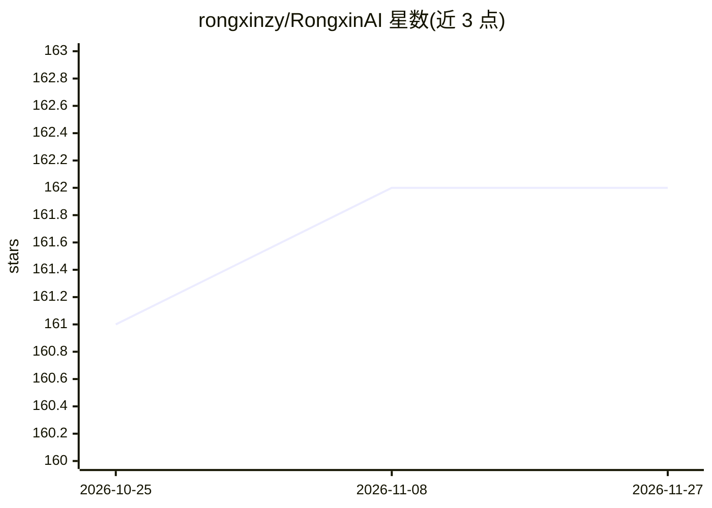

# rongxinzy/RongxinAI

⭐ 162 · TypeScript · AGPL-3.0 · 推送 2026-11-26 · [GitHub](https://github.com/rongxinzy/RongxinAI) · [官网](https://www.rongxzyai.com) · 组织维护 · 中文 README

**桌面 AI 智能体：内置免费模型+本地 GGUF，可从微信/飞书/钉钉派任务**

基于 Electron 的开源桌面 AI 智能体（AGPL-3.0），用户以自然语言派任务，agent 可读写文件、执行命令、经 Playwright 操作浏览器，生成 PPT/Word/PDF/Excel 输出。内置免费模型（需联网），也可经模型市场下载 GGUF 模型由 llama.cpp 本地运行，可调上下文长度/GPU/线程；通过微信、企业微信、钉钉、飞书、QQ、Telegram、Discour 及邮件通道接收任务。支持 Experts/Skills/MCP 扩展与定时任务，会话与配置本地存储，工具执行有审批模式。提供 Windows/macOS/Linux 安装包，并区分 lite/cpu/cuda 版。

## 筛选速览

| 维度 | 判定 | 备注 |
|---|---|---|
| AI 角色 | `ai-native` | 本体是模型或模型工具 |
| 许可风险 | `viral` | AGPL-3.0 |
| 部署形态 | `desktop` | 安装包/桌面程序 |
| 模型依赖 | local-ok | 支持本地模型 |
| 硬件要求 | — | 无带数字的原话,不猜 |
| 安装摩擦 | `medium` | 含编译或系统依赖之一 |
| 成熟度 | — | 结构信号不足 |

## 能力要点

- 内置免费模型，无需第三方 API key 即可开始
- 本地 GGUF 模型市场，基于 llama.cpp 运行时，可调上下文/GPU/线程
- 文件读写、命令执行与 Playwright 浏览器操作三类 agent 能力
- 微信/企业微信/钉钉/飞书/QQ/Telegram/Discord 及邮件通道接收任务

## 适用场景

- 让桌面 agent 整理本地文件并生成文档或幻灯片
- 在微信/飞书里直接给 agent 派任务并跟进进度
- 在本地跑 GGUF 模型处理任务，减少对云端推理的依赖

## 场景标签

`AI 助手` `浏览器自动化` · 领域:效率与自动化

## 证据(README 行号)

> L5:  The open-source, local-first desktop AI agent — start free with a built-in model, run GGUF models locally, and assi
> L31: - 🛠️ **Actually does the work** — reads & writes files, runs commands, operates a browser through the Playwright co

## 星数曲线

2026-10-25 161 → 2026-11-27 162（+1）

---
*卡片 v1 · prompt 1.4 · 生成 2026-11-27 · 置信度 high · 依据 README sha `b16da6d93505` · [字段定义](../../DATASET.md)*
