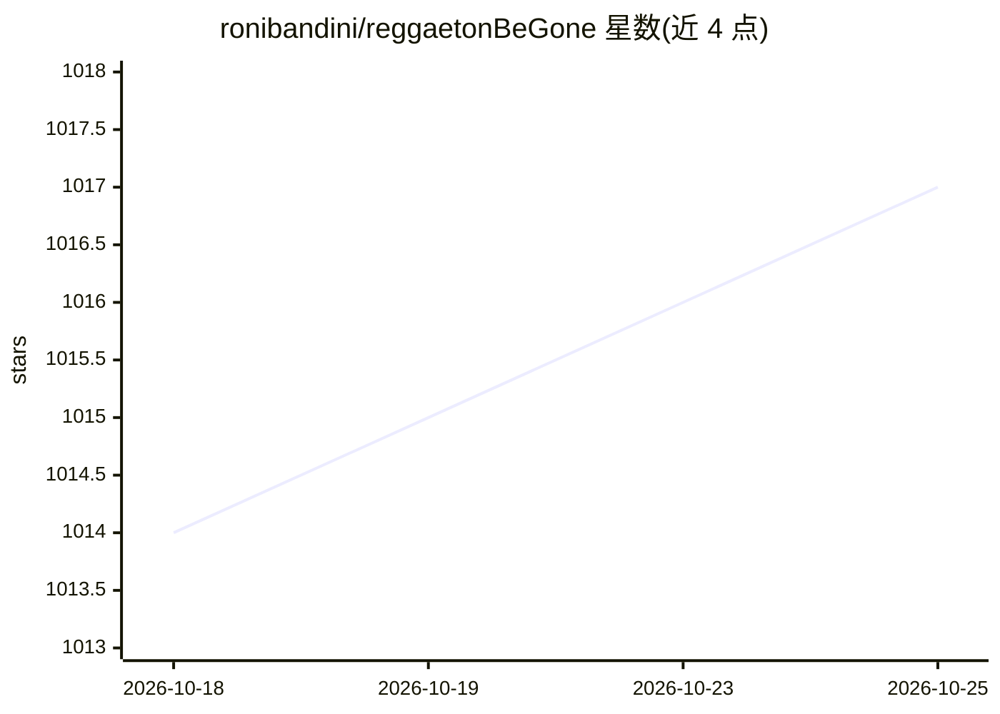

# ronibandini/reggaetonBeGone

⭐ 1,017 · Python · MIT · 推送 2026-08-22 · [GitHub](https://github.com/ronibandini/reggaetonBeGone) · [官网](https://bandini.medium.com/reggaeton-be-gone-6fa55f46a9d7) · 个人维护

**树莓派设备：识别雷鬼顿音乐并触发蓝牙干扰测试**

运行于 Raspberry Pi 3 的边缘 ML 实验设备：通过 USB 麦克风持续采样环境音频，用 Edge Impulse 音频分类模型（16 kHz 单声道，标签 reggaeton/otros）在本地推理，在 128×32 SSD1306 OLED 显示置信度，超过可配置阈值（默认 0.95）时对配置的蓝牙音箱触发多种实验性测试方法。按键启动、带时间戳日志。公开参考模型仅用 6 首歌训练，模型卡建议扩大数据集；代码限定在自有硬件的受控实验场景。以 git clone 源码方式安装，需 Python 3 与 Edge Impulse Linux SDK 等依赖。

## 筛选速览

| 维度 | 判定 | 备注 |
|---|---|---|
| AI 角色 | `ai-native` | 本体是模型或模型工具 |
| 许可风险 | `permissive` | MIT |
| 部署形态 | `None` |  |
| 模型依赖 | — | README 未给出锁定关系 |
| 硬件要求 | — | 无带数字的原话,不猜 |
| 安装摩擦 | `low` | 无编译、无系统依赖或容器化 |
| 成熟度 | `idea` | |

## 能力要点

- Edge Impulse 音频分类模型本地推理（reggaeton/otros 二分类）
- 可配置置信度阈值，默认 0.95，OLED 实时显示
- GPIO 26 物理按键启动，log.txt 时间戳日志
- 公开参考模型托管于 Hugging Face

## 适用场景

- 在自有蓝牙音箱上测试音频分类触发流程
- 作为边缘 ML 音频分类的硬件项目复现
- 了解用少量样本训练音乐类型分类器的局限

## 场景标签

`网络安全` · 领域:学习与行业

## 证据(README 行号)

> L18: It continuously samples ambient audio, uses an **Edge Impulse audio-classification model** to determine whether reg
> L25: * 🧠 Edge Machine Learning

## 星数曲线

2026-10-18 1,014 → 2026-10-25 1,017（+3）

---
*卡片 v1 · prompt 1.4 · 生成 2026-10-21 · 置信度 high · 依据 README sha `f9f5577c42db` · [字段定义](../../DATASET.md)*
