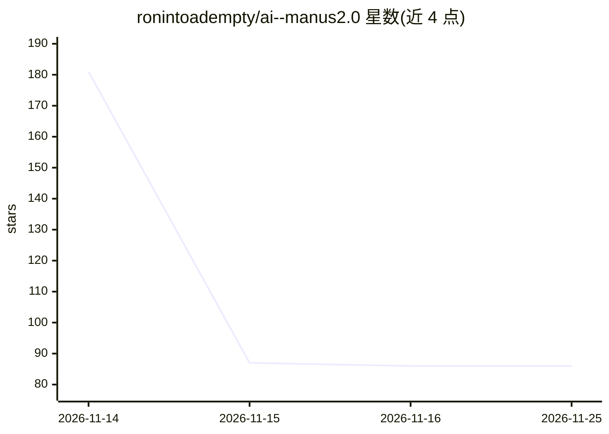

# ronintoadempty/ai--manus2.0

⭐ 86 · Apache-2.0 · 推送 2026-11-15 · [GitHub](https://github.com/ronintoadempty/ai--manus2.0) · 个人维护

**面向个人用户的自主 AI Agent：代为执行代码与浏览器操作**

定位为自主 AI 代理系统，宣称可在沙箱环境中运行各类工具：自主编写并执行脚本、控制浏览器（导航页面、填写表单、抓取信息）、跨会话记忆工作流模式，并以个人助手形式在后台运行。目标用户为非开发者个人（学生学习研究、远程工作者、家庭与轻办公场景）。README 提供系统兼容性表（最低 4 GB 内存、双核 CPU）与使用步骤说明，但未给出具体安装命令、模型接入方式或代码仓库结构等技术细节，技术可验证性有限。

## 筛选速览

| 维度 | 判定 | 备注 |
|---|---|---|
| AI 角色 | `ai-native` | 本体是模型或模型工具 |
| 许可风险 | `permissive` | Apache-2.0 |
| 部署形态 | `None` |  |
| 模型依赖 | — | README 未给出锁定关系 |
| 硬件要求 | — | 无带数字的原话,不猜 |
| 安装摩擦 | `low` | 无编译、无系统依赖或容器化 |
| 成熟度 | — | 结构信号不足 |

## 能力要点

- 自主代码执行：编写并运行脚本完成多步任务
- 浏览器控制：导航网页、填表单、采集信息
- 跨会话保持任务模式的一致性
- 定位家庭、学习与轻量工作的小规模场景

## 适用场景

- 让学生整理研究笔记、跑快速计算
- 让代理在多页面间采集数据并汇总
- 把重复性小任务（查页面、整理文件）委托给后台代理

## 场景标签

`编码 Agent` `浏览器自动化` `AI 助手` · 领域:效率与自动化

## 证据(README 行号)

> L10: - **Autonomous Code Execution:** Manus AI agent runs code on its own to complete tasks, so you can focus on decisio
> L18: Manus is an autonomous AI agent designed to run code and control a browser on your behalf. Instead of acting like a

## 星数曲线

2026-11-14 181 → 2026-11-25 86（-95）

---
*卡片 v1 · prompt 1.4 · 生成 2026-11-17 · 置信度 low · 依据 README sha `637da4fbcded` · [字段定义](../../DATASET.md)*
