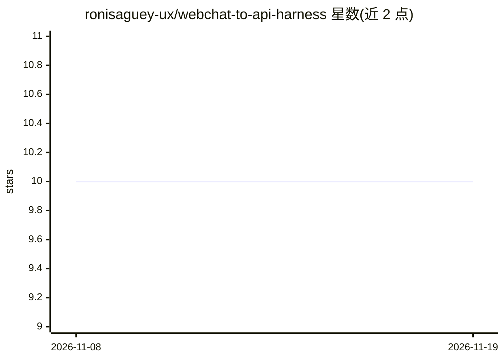

# ronisaguey-ux/webchat-to-api-harness

⭐ 10 · JavaScript · 推送 2026-11-15 · [GitHub](https://github.com/ronisaguey-ux/webchat-to-api-harness) · [官网](https://rs-systems-web.com) · 个人维护

**把已登录网页聊天会话转为 OpenAI/Anthropic 兼容 API 的网关**

用 Puppeteer 驱动真实浏览器中的网页聊天标签页（DeepSeek 为主目标，另含 ChatGPT、Gemini、Kimi、Claude 等模式），对外提供 OpenAI 与 Anthropic 兼容端点，供 Aider、LiteLLM、Claude Code 等 agent wrapper 接入，并支持文件读写与 bash 工具调用。登录由用户手动完成，harness 不接触密码；提供工具调用轮次上限、限流冷却、上下文交接、沙箱路径围栏等机制。限制：每个站点是独立集成，行为受站点 DOM 变化影响；headless 模式会导致账号登出。需 Node.js 20.12+ 与有界浏览器。

## 筛选速览

| 维度 | 判定 | 备注 |
|---|---|---|
| AI 角色 | `ai-ecosystem` | LLM/agent 周边工具 |
| 许可风险 | `none` | — |
| 部署形态 | `desktop` | 安装包/桌面程序 |
| 模型依赖 | — | README 未给出锁定关系 |
| 硬件要求 | — | 无带数字的原话,不猜 |
| 安装摩擦 | `low` | 无编译、无系统依赖或容器化 |
| 成熟度 | — | 结构信号不足 |

## 能力要点

- 提供 OpenAI/Anthropic 兼容 API，供 Aider、Claude Code、LiteLLM 客户端接入
- 支持工具调用：read_file、write_file、list_dir、run_bash，路径受沙箱 allowlist 围栏
- 8 种 webchat 模式（deepseek/chatgpt/gemini/kimi/claude 等）+ generic 兜底，内置 per-site 选择器
- webchat 网页设置映射为模型 id（如 webchat/deepseek/deepthink+search），自动续答与上下文交接

## 适用场景

- 用已有的付费网页聊天订阅驱动 Claude Code/Aider 等 agent 工作流
- 为本地代码 agent 提供带文件与 bash 工具调用的兼容 API 端点
- 在 Xvfb 虚拟显示上无人值守运行网关

## 场景标签

`模型网关` `浏览器自动化` `聊天机器人` · 领域:Agent 开发

## 证据(README 行号)

> L5: An OpenAI- **and** Anthropic-compatible API backed by a real webchat tab
> L8: a webchat session you own, with tool-call support (read/write files, bash, …).
> L35: **Why a webchat at all:** this turns a chat session you already pay for into an

## 星数曲线

2026-11-08 10 → 2026-11-19 10（+0）

---
*卡片 v1 · prompt 1.4 · 生成 2026-11-19 · 置信度 high · 依据 README sha `6cb00d140b7d` · [字段定义](../../DATASET.md)*
